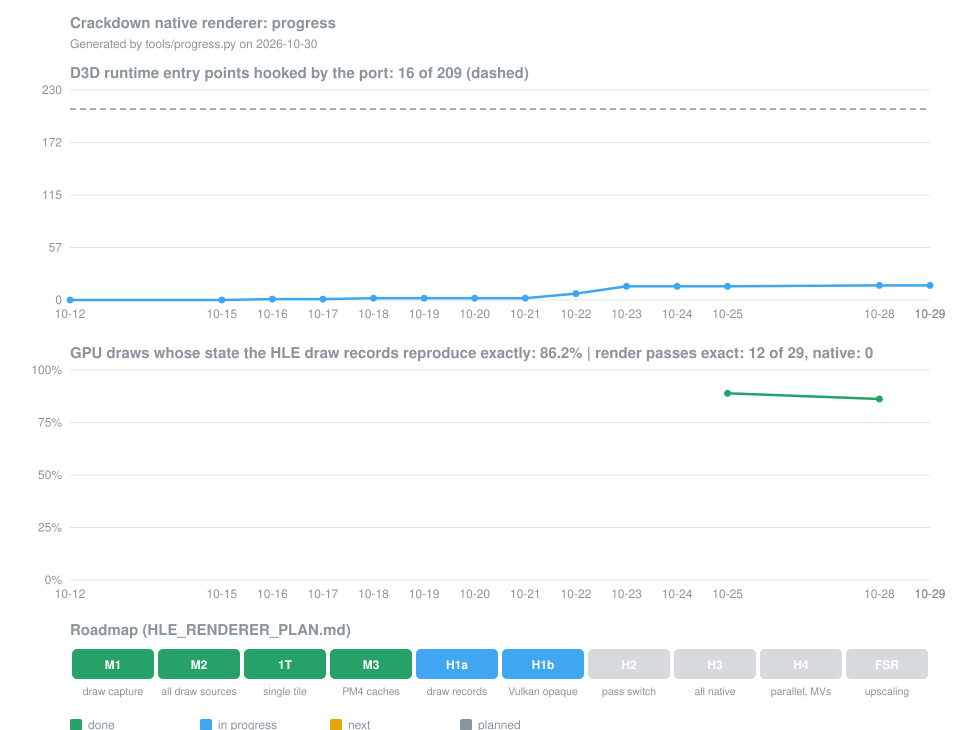

<div align="center">

# Crackdown - PC Port

### Crackdown for Xbox 360, running natively on Windows, and experimentally on Linux and Steam Deck, through static recompilation, with the TRG launcher and modern PC options

[](https://github.com/saulob/crackdown-xbox360-recompiled/releases/latest)
[](https://github.com/saulob/crackdown-xbox360-recompiled/releases)


<sub>The original Xbox 360 game code, statically recompiled to native PC code with the <a href="https://github.com/rexglue/rexglue-sdk">ReXGlue SDK</a>. <b>No game files included</b>: bring your own Crackdown disc.</sub>

</div>


Crackdown Recompiled is a native PC recompilation of Crackdown for Xbox 360, with enhanced graphics, high frame rates, modern display support, keyboard and mouse support, a full launcher, offline achievements, language selection, and native Windows support plus experimental Linux / Steam Deck support.

## This fork: a native renderer, built for the Steam Deck

This fork follows the upstream releases (currently v0.6.2) and works on one goal: **drawing the game with a native
Vulkan renderer instead of emulating the Xbox 360 GPU**, with the **Steam Deck** as the primary target and Windows
running the same renderer. A 2007 game fits a handheld well, but today every frame still goes through an emulation of
the Xenos GPU: the game writes Xbox 360 command packets, and the GPU plugin parses them, emulates the 10 MB EDRAM and
replays the scene once per screen tile. On the Deck's four CPU cores that emulation, not the GPU, is the limit. Once
the game's draws reach a renderer that understands them, the same draw records feed **FSR upscaling** (motion vectors
need per-object draw identity) and, later and optionally, ray-traced lighting.

[](docs/progress/history.json)

The chart is generated by `tools/progress.py`: the first panel recounts, for every day of the git history, how many of
the game's 209 D3D runtime entry points (the functions the engine calls to draw, set state, resolve and replay command
buffers) the port intercepts; the second shows, capture by capture, the share of GPU draws whose complete register
state the draw records reproduce. The plan, the measurements behind each step and the open problems are in
`HLE_RENDERER_PLAN.md` (kept next to the repository).

### Done so far

- **Measuring first.** An in-game sampling profiler (F6), per-frame GPU command statistics, and an F8 capture that
  records the same frames twice, from the game's D3D device and from the GPU command processor, plus the contents of
  every resolve, so each render pass can be compared image by image.
- **Every draw accounted for** (milestones M1-M2). The game issues 1,300-2,600 D3D draws a frame but the GPU executes
  8,000-10,000: each scene draw was replayed once per EDRAM tile, and about half of them come from precompiled command
  buffers inside the mesh assets. A walker over the game's command stream reproduces the state of 99.9% of the GPU's
  draws.
- **Single-tile scene** (experimental, `crackdown_single_tile_scene`). The 720p scene is rendered in one tile at 1x
  MSAA instead of two tiles at 2x, so each draw runs once: 116 to 193 FPS at the same city spot. The two-tile
  assumptions baked into the light pools, the shadow mask and the vehicle shadow decals (720/480 literals, 1/484 texel
  sizes in shaders) were found with the capture tools and corrected.
- **Faster GPU command processing** (SDK patches 0107-0112). Cached translation of the static command buffers, caches
  for texture and sampler fetch constants, and a memo for EDRAM bookkeeping: about -12% of the command processor's work
  per draw and +16-18% draws per second in the city. These stay on the emulation path, which remains the reference.
- **Simulation speed above 30 FPS.** Crowd pedestrians and the far traffic moved up to 8x too fast at high frame
  rates; the Agency garage door and some light fades too. Fixed per update step.
- **Game-side draw records** (milestone H1a). Every draw, clear, resolve and command buffer replay becomes a compact
  record built from the game's own D3D device state, with the state the GPU receives outside the device (shader
  literal constants, the engine's prebaked command packets, command buffer writes) tracked on top. Records are
  tagged with the render pass that produced them. Against the GPU trace, 86-89% of all draws and **100% of the opaque
  scene's draws** are reproduced exactly, at about 290 ns a record.
- **A map of the renderer.** A call graph of the 30,000 recompiled guest functions locates the frame (`sub_82324330`),
  the scene bracket (`sub_82326A90`) and the order of its ~30 render passes: shadow maps and atlas, depth prepass and
  opaque scene, normal/shadow buffers, half-resolution lighting, light pools, particles, post-processing and HUD.
- **Upstream kept in.** Merged up to v0.6.2; the update system was audited (HTTPS to GitHub only, SHA-256 checked before
  extraction, no elevation, no malicious code found). This fork's builds do not check for updates
  (`crackdown_update_check`, off), so an upstream release cannot replace them.
- **Vulkan on Windows too** (H1b, step 1). The GPU plugin carries the Vulkan backend on Windows as well, and
  `gpu_backend = "vulkan"` runs the whole game on it, as on the Steam Deck. The Vulkan ports of our renderer fixes now
  apply on both platforms (occlusion queries, render target transfers, resolve handling), and float24 depth is
  converted in the pixel shader under Vulkan, which the Agency garage's markers need. At the usual city spot Vulkan runs
  130-140 FPS against 190-200 on D3D12: its GPU command thread is the limit (~8 ms a frame), which the next ports
  address. Per-section timers of the Vulkan draw path and an in-run A/B switch (`gpu_ab_cvar`, one setting alternated
  every 10 s so both sides see the same scene) measure each change. Two by-draw costs went first (a by-name cvar
  lookup on every draw, samplers parsed again for each draw), then the biggest: a constants descriptor set was written
  for every draw; with dynamic uniform buffers none is, and the city spot went from ~115 to ~145 FPS on Vulkan. The
  GPU command optimizations that were Windows only (command buffer cache, fetch constant caches, EDRAM memo) now
  apply to the Linux build too, so the Steam Deck gets them.

### Next

1. **H1b**: render the opaque scene from the draw records with Vulkan, offscreen, next to the emulated frame, and
   compare the images.
2. **H2**: switch the scene to the native renderer one render pass at a time, starting with the depth prepass.
3. **H3**: every pass native, the emulation only as a fallback.
4. **H4**: record draws on several threads (the Deck's four cores), per-object previous-frame transforms for motion
   vectors, then **FSR**.

## Features

### Graphics & Display
- **Render Resolution up to 4x**: 1x (Original, 1280x720 at 16:9), 2x, 3x or 4x, including 4K-class output depending on the selected aspect ratio and display setup.
- **Internal Render Resolution**: 100% Native, 75% Performance or 50% Low-end. The GPU draws the game at that share of the Render Resolution and the picture is scaled up to it, for more speed on slower GPUs.
- **Native Aspect Ratio**: 16:9 Original, 16:10, **21:9 Ultrawide**, **32:9 Super Ultrawide**, 4:3 and 5:4. The game renders in the chosen format, so wider formats show more of the scene to the sides. Menus and videos made for 16:9 are not redesigned for every format.
- **Presentation**: Letterbox keeps the picture's proportions in a window of another shape; Stretch fills the window.
- **Windowed or Borderless Fullscreen**, with **F11** to switch while playing, and monitor selection.
- **Graphics card selection** (Windows): choose which compatible GPU renders the game.

### Graphics fixes
- **Modern button prompts**: the HUD's old Xbox 360 button glyphs are replaced by sharp modern ones, and the HUD text is
  redrawn from the system's Arial (the game's own typeface) at twice the original atlas resolution. With keyboard and
  mouse in use, prompts show your bound keys and switch back to the controller glyphs as soon as a pad is used.
- **Corrected exposure and brightness**: scenes where the exposure stayed stale or wrong now adapt properly, without the frame rate cost of a full readback.

### Performance
- **Frame rates**: 30 (Original), 60 (Recommended, the default), 90, 120, 144, 165, 240 and **Unlimited**. Game speed stays the same at every rate.
- **Missed frames no longer slow the game down**: at 30 and 60 FPS the game catches up, so game time keeps its normal speed when the PC misses a frame. 90 FPS and higher, including Unlimited, are paced by the host for even frame delivery; when the PC cannot hold the selected rate, the game steps by a smoothed measure of the real frame time, so a frame rate dip keeps the game at normal speed without upsetting its physics. To test that, `crackdown_debug_frame_dips = <ms>` in `settings.toml` adds up to that many milliseconds to frames, sweeping every 6 s with random jitter and rare stalls (see `docs/rexglue-patches.md` for the other developer diagnostics).
- **Lower CPU overhead and better scaling at high frame rates**, with improved performance in demanding city scenes and better use of modern CPUs.
- **Faster graphics command processing**, with less repeated GPU state work, fewer redundant memory uploads, and less render-target and texture-sampler work per draw.
- **Direct3D 12 submission on its own thread** (Windows): graphics submission runs independently of the main GPU command processor thread. On CPUs with eight or more logical processors, the heavy graphics host threads are also scheduled away from the first two.
- **Less waiting on the GPU**, with reduced synchronization and fence overhead on both platforms.
- **Improved audio synchronization** and audio worker thread behavior.
- **Compatibility fixes** for the recompiled game's graphics and audio.

### Quality of Life
- **Offline achievements** with the original icons and Gamerscore: an **Achievements** page in the launcher and an in-game overlay on **F7**, usable with keyboard or controller.
- **Cheats**: 9 optional cheats set on the launcher's **Cheats** page, and changed for the session with the in-game menu on **F10**, including markers for the agility and hidden orbs you have not collected yet on the minimap and the pause menu's map.
- **Save-load fix**: the crash that could happen after Loading Saved Game is fixed.
- **High frame rate fixes**: above 30 FPS, no more launches on slopes or off ledges, no speed build-up running down
  stairs and slopes, fewer characters stuck in walls, rockets and grenade rounds explode on impact again, and the
  explosion and ragdoll crash in the camera and audio engine is fixed.
- **Xbox 360 vector math**: multiply-adds and dot products round once, as on the console.
- **Language selector** with ten launcher choices: English, French, German, Italian, Spanish (Spain), Spanish (Latin America), Czech, Polish, Hungarian and Japanese.
- **Skip intro**: starts directly at the title screen.
- **Frame rate and render resolution in the window title**, and an **FPS counter** in the corner (toggled with **F2**).
- **Full launcher** with an installer for your disc image or extracted files, and display, graphics and gameplay options. Author and project links open in the browser.
- **Keyboard and mouse support** with mouse aiming, menu navigation and configurable mouse sensitivity, while Xbox controllers continue to work normally.
- Portable `user_data` folder for saves, settings and caches.
- **Diagnostics**: optional detailed logging, an **Open logs folder** button, and on Windows a crash appends a `CRASH REPORT` block to the same session log (no separate crash file or minidump), and a freeze writes every thread's call stack to `hang_<n>.txt` in the logs folder.

### Platforms
- **Windows** (primary): native build using Direct3D 12.
- **Linux x86_64 and Steam Deck** (**Experimental**): native build using Vulkan, shipped as an AppImage. Not Proton or Wine.

## What you need

- **Windows**: Windows 10 or 11, 64-bit, a DirectX 12 graphics card and the latest Microsoft Visual C++ 2015-2022 Redistributable (x64), **or**
- **Linux / Steam Deck**: 64-bit x86 Linux with glibc 2.31 or newer, a Vulkan driver and an X11 or Wayland desktop
- **Your own Crackdown disc** for Xbox 360, this exact game version:

| | |
| --- | --- |
| Game | Crackdown, Xbox 360 retail disc (2007), original release without a title update |
| Title ID | `4D5307DC` |
| `Default.xex` | 14,270,464 bytes, SHA-256 `7AAA7A8920D1C3C737E58CF583DEBAFE6013BE0A96BEC3EC136E5DE7E3377E5A` |
| Game files | 196 files, 6,555,220,594 bytes (about 6.1 GiB), copied from the disc |

The launcher accepts the disc image (`.iso`) or a folder holding the files extracted from the disc, and checks `Default.xex` and every required file against this table. Any other version is refused, because the port is built for this exact game code. The `$SystemUpdate` folder on the disc is not needed and is not copied.

## Installing

### Windows

1. Download **Crackdown-v0.6.2-windows-x64.zip** from the [latest release](https://github.com/saulob/crackdown-xbox360-recompiled/releases/latest) and extract it anywhere you can write to.
2. Run **crackdown.exe**. The launcher opens.
3. On the **Play** page click **Install from disc image...** and pick your Crackdown `.iso`, or click **Install from folder...** for extracted disc files. You can also drop either on the launcher window.
4. Wait until **Ready to play** appears. The game files are copied into the `game` folder next to the program.
5. Press **PLAY**.

**Reinstall from disc image...** repairs the game files and keeps your settings and saves.

Windows may warn the first time you run the program, because the release is not digitally signed. If you downloaded it from this repository's releases page, choose **More info**, then **Run anyway**.

### Linux and Steam Deck

**Experimental.** Crackdown Recompiled includes a native Linux x86_64 build using ReXGlue's Vulkan backend. It does not use Proton or Wine, and the AppImage contains the same platform-neutral game and launcher features as the Windows build, including the keyboard and mouse implementation. It is built and checked by automated scripts and tests, but this release has not yet been fully validated on real Linux PCs or Steam Deck hardware, and keyboard and mouse input has been tested manually on Windows only. Reports are welcome.

1. Download **CrackdownRecompiled-v0.6.2-x86_64.AppImage** from the release and mark it executable (right-click > **Properties** > **Permissions** > **Is executable**, or `chmod +x`).
2. Run it, then install your disc image from the **Play** page as on Windows. The game files go in a `game` folder next to the AppImage.
3. On a Steam Deck, do this in **Desktop Mode**, then add the AppImage with **Games > Add a Non-Steam Game to My Library** and play it from **Game Mode**.

If the system cannot mount AppImages with FUSE, the AppImage unpacks itself into a temporary folder and runs from there. Everything is shared with Windows except **Graphics card selection**, which chooses a Direct3D 12 adapter and so exists on Windows only. Settings and saves are in `user_data`, and logs in `logs`, both next to the AppImage. Requirements, the startup behavior and building the AppImage are in [docs/linux.md](docs/linux.md).

**No game files are included** in either download.

## Hotkeys

| Key | Action |
| --- | --- |
| **F11** | Switch between Windowed and Borderless Fullscreen while playing |
| **F7** | Open the achievements list |
| **F10** | Open the Cheats menu (single player) |
| **F2** | Show or hide the FPS counter |
| **Shift** (held while starting) | Bring the launcher back |

## The launcher

The launcher opens before the game. Your choices are saved to `settings.toml` in the `user_data` folder. To turn the launcher off, set **Show this launcher** to **Off** on the Play page. Hold **Shift** while starting to bring it back.

### Play
- **Install from disc image...**, **Install from folder...** and **Reinstall from disc image...**, with the game version checks
- The **Ready to play** status, and the **Show this launcher** setting

### Display
- **Display mode**: Windowed or Borderless Fullscreen. Press **F11** while playing to switch between them.
- **Window size** and **Monitor**. The launcher reopens at its last position and size, maximized or in its own F11 fullscreen if it was. This is separate from the game's Display mode.
- **Aspect Ratio**: 16:9 Original, 16:10, 21:9 Ultrawide, 32:9 Super Ultrawide, 4:3 or 5:4. It sets the game's target rendering format, and the Window size choices follow it.
- **VSync** on or off
- **Presentation**: Letterbox or Stretch

Window size, monitor, VSync and graphics card take effect when you press **PLAY**. If one differs from the launcher's window, the game restarts once in a new window.

### Graphics
- **Graphics card** (Windows): the GPU that renders the game; the first detected one is the default
- **Render resolution**: Original (1280x720 at 16:9), 2x (recommended for 1440p), 3x or 4x
- **Internal render resolution**: 100% Native, 75% Performance or 50% Low-end
- **Anti-aliasing**: Off, FXAA or FXAA Extreme
- **Multisampling**: 2x MSAA (default), or 4x MSAA (Compatibility) if 2x shows graphics problems on your GPU or driver
- **Texture filtering**: Game, Off, 2x, 4x, 8x or 16x

### Gameplay
- **Language**: the game's text and interface language. Choose English (the default), French, German, Italian, Spanish (Spain), Spanish (Latin America), Czech, Polish, Hungarian or Japanese. The available resources come from your own game files, and the language is applied when the game starts.
- **Skip intro**: starts directly at the title screen, without the startup videos. Off by default.
- **Frame rate**: 30 (Original), 60 (Recommended), 90, 120, 144, 165, 240 or Unlimited
- **Frame rate in title**: shows the frame rate in the window title, for example `Crackdown Recompiled | FPS: 60.00`. On by default.
- **Render resolution in title**: shows the render resolution in the window title, for example `Crackdown Recompiled | 2560x1440 | FPS: 60.00`. Off by default.
- **Frame counter**: shows the frame rate and frame time (`60 FPS  16.7 ms`) in the top-right corner. Hidden by default. Press **F2** while playing to show or hide it for the session.

### Cheats
Optional gameplay modifiers, all off by default. They start with the values saved here, and **F10** in the game changes them for that session only, without touching the launcher settings (keyboard: **Up** / **Down**, **Enter**, **Esc**; controller: D-pad or left stick, **A**, **B**). Cheats apply to the local player in single player only.
- **Infinite Health**, **No Fall Damage**, **Infinite Ammo** and **Infinite Vehicle Health** (the vehicle you drive): Off or On
- **Movement Speed** and **Jump Height**: Off, 2x, 4x, 6x, 8x or 10x
- **Vehicle Speed**: Off, 2x, 4x or 6x
- **Agility Orbs on Map** and **Hidden Orbs on Map**: Off, Minimap, or Minimap + World. Marks the orbs you have not collected yet, green for agility and magenta for hidden, on the minimap and, with Minimap + World, on the pause menu's city and district maps.

### Controls
- Xbox and XInput controllers work without setup; any connected pad can press Start
- **Keyboard and mouse**: enabled or disabled (off by default). By default **W A S D** move, the mouse turns the camera and aims, the **left mouse button** fires and the **right mouse button** locks on. It works together with any connected Xbox controller.
- **Direct mouse look**: the mouse turns the camera directly, not by emulating the right stick, so there is no stick deadzone or speed curve. A click in gameplay captures the mouse. **Esc** always releases it, and so do the keys bound to Start and Back, so rebinding those also changes which keys release it.
- **Mouse sensitivity**: 0.10x to 10.00x (default 1.00x).
- **Remappable keyboard controls**: every keyboard control, including Start and Back, can be rebound on the Controls page: click a control, then press the new key (**Esc** cancels). **Reset to defaults** restores the default keys and sensitivity. By default, plain arrow keys also turn the camera, and menus use **W A S D** or **Shift + arrow** keys.

### Achievements
- Every achievement with its icon, description, Gamerscore and unlock status. It shows the same progress as the in-game **F7** list.

### About
- The port version, game version and library versions
- Open the game folder, or the saves and settings folder
- **Show settings file**, and **Reset all settings**

## Offline achievements

Crackdown includes offline achievement tracking with the original achievement icons and Gamerscore. Press **F7** while the game is running to open the achievement list, which shows each achievement's icon, description, Gamerscore, unlock status and progress. Unlock progress is saved automatically on this PC.

Everything stays offline: there is no Xbox Live connection, Microsoft sign-in or online achievement synchronization.

The launcher's **Achievements** page shows the same list without starting the game. In the game, **F7** opens the overlay, which can be scrolled and closed with the keyboard or a controller.

## Known issues

- Background music may occasionally stop during gameplay while sound effects and voices continue.

## Screenshots


## Reporting problems

If the game does not start or crashes, please open an [issue](https://github.com/saulob/crackdown-xbox360-recompiled/issues). Attach the newest `crackdown_*.log` file from the `logs` folder next to the program (next to the AppImage on Linux), and say what you were doing when the problem happened. The launcher's **About** page opens that folder. **Detailed logging** is on by default; turned off, a normal session still writes a shorter log but discards it on exit, while a crash keeps it. After a crash on Windows the same log ends with a `CRASH REPORT` section; no separate crash file or minidump is written. For Linux reports, please also say your distribution and graphics card, and whether you start the AppImage from Steam.

## Building it yourself

The recompiled C++ is generated from your own game files, so the repository does not contain it. Clone with submodules, so the TRG launcher is included:

```powershell
git clone --recurse-submodules https://github.com/saulob/crackdown-xbox360-recompiled.git
```

In an existing clone, run `git submodule update --init --recursive`.

1. Install Visual Studio with the C++ and LLVM/Clang components.
2. Extract the files of your disc into `game\assets`, so that `game\assets\Default.xex` exists.
3. `.\tools\codegen.ps1` downloads the pinned ReXGlue SDK 0.10.0, checks `Default.xex` and generates the C++ into `generated\`.
4. `.\tools\build.ps1` builds `build\crackdown.exe`. It first checks that ReXGlue's runtime and Xenos GPU plugin in `tools\rexglue` were built from this project's patches (`patches\rexglue-sdk`) and rebuilds them from the v0.10.0 source when they were not (network access the first time). It does not regenerate the C++; when that is stale it says so.
5. `.\tools\package-release.ps1` makes the release ZIP in `dist\`. It builds the same way, builds the update helper `trg-updater.exe` with MSYS2 CLANG64 (`pacman -S mingw-w64-clang-x86_64-toolchain`), refuses to package a runtime that does not match the patches, and publishes nothing.
6. `.\tools\test.ps1` builds and runs the tests that need no game files.

The Linux AppImage is built on Linux or WSL with `tools/package-linux.sh`, after the steps above have generated the C++, and `tools/build.sh` makes a plain Linux build without packaging. See [docs/linux.md](docs/linux.md) and [docs/build-workflow.md](docs/build-workflow.md).

## Sponsoring

Crackdown Recompiled is maintained and developed in my free time. If you enjoy the project or find it useful, consider supporting its continued development.

<p align="center">
<a href="https://github.com/sponsors/saulob" target="_blank"></a>
</p>

## Credits

- Crackdown by Realtime Worlds, published by Microsoft Game Studios (2007). This is an unofficial fan-made PC port. It is not affiliated with or endorsed by Microsoft or Realtime Worlds, and it contains none of their files.
- [ReXGlue SDK](https://github.com/rexglue/rexglue-sdk) for the recompiler and runtime (BSD 3-Clause)
- [TRG Launcher](https://github.com/TekRantGaming/trg-launcher), the launcher interface, pinned at v1.1.0, licensed under the MIT License
- The licenses of the libraries the release includes are in the `licenses` folder of the ZIP and in the AppImage

## AI disclosure

AI tools were used to assist with code analysis, development, debugging and documentation. Changes were directed, tested and reviewed by the maintainer.

## License

Original code in this project is licensed under the GNU General Public License v2.0 only (GPL-2.0-only). See [LICENSE](LICENSE).

Third-party components retain their respective licenses and notices. See [packaging/licenses/ReXGlue-LICENSE.txt](packaging/licenses/ReXGlue-LICENSE.txt) and [packaging/licenses/THIRD-PARTY-LICENSES.txt](packaging/licenses/THIRD-PARTY-LICENSES.txt).

No game files are included. Crackdown and its assets are not covered by this project's license.
