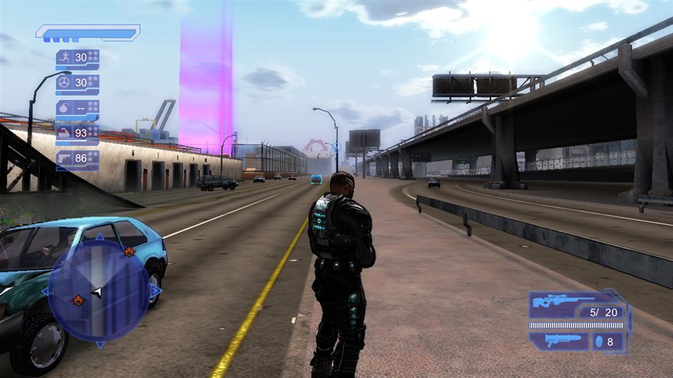
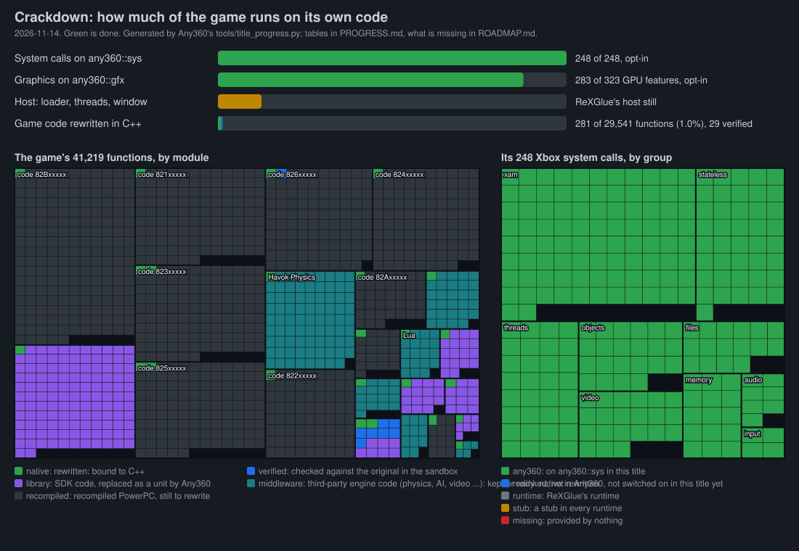
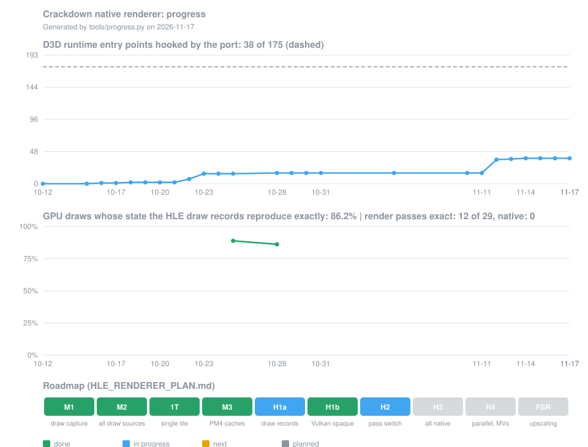

# Crackdown Rewrite

<p align="center">

</p>

**Crackdown (Xbox 360, 2007), statically recompiled to native PC code and rewritten, step by step, onto [Any360](https://github.com/GaetanVigner/Any360).** It follows [saulob's PC port](https://github.com/saulob/crackdown-xbox360-recompiled) (currently v0.6.2: launcher, offline achievements, 4K and ultrawide, keyboard and mouse) and works on one goal: the game on its own code, with nothing of the console left under it, the Steam Deck as the first target and Windows running the same code.

**No game data and no game binaries are here.** Bring your own Crackdown disc.

## Where the rewrite stands

<!-- progress:begin -->
[](docs/progress/PROGRESS.md)

| | Where it stands |
|---|---|
| **System calls** | 248 of 248 on `any360::sys` (opt-in) |
| **Graphics** | `any360::gfx`, a Vulkan renderer handling 283 of 323 Xbox 360 GPU features (opt-in) |
| **Host** | ReXGlue's loader, threads and window; Any360's own host is not started |
| **Game code** | 281 of 29,541 functions rewritten in C++ (1.0%), 29 more verified against the original |

Updated 2026-11-12. Every system call, module and rewritten function: [PROGRESS.md](docs/progress/PROGRESS.md). What is missing, step by step: [ROADMAP.md](docs/progress/ROADMAP.md). Function by function: [functions.csv](docs/progress/functions.csv).
<!-- progress:end -->

## What this is

The game's PowerPC executable is translated ahead of time into C++ ([ReXGlue](https://github.com/rexglue/rexglue-sdk)) and compiled for the PC, so the game's own code runs directly on the processor. Under it, something has to stand in for the console: its system calls, its GPU, the libraries the game was linked with. In a recompilation port that is an emulation layer. Here it is replaced piece by piece by native code, and the game's own functions are then rewritten in C++, each proven against the original, until the result is an ordinary portable program.

| Step | What runs under the game | State here |
|---|---|---|
| Recompiled | ReXGlue's runtime: emulated kernel, emulated GPU | the whole game plays, as upstream's port does |
| System calls | `any360::sys`, native implementations of the Xbox 360 system calls | all eight groups, opt-in on `main`: `--any360_sys_groups=stateless,files,objects,threads,memory,xam,input,audio`; no call reaches ReXGlue's kernel then |
| Graphics | `any360::gfx`, a Vulkan renderer fed by the game's own draw commands | opt-in on `main`: `--any360_gpu=true` (resolution scale, host MSAA, pipeline cache); 160-220 FPS at 1440p with 4x MSAA in the city on an RTX 5070 Ti |
| Library functions | `any360::xdk`, host versions of the XDK functions linked into the game | five memory functions (`memcpy`, its forward copy, `memmove`, `memset`, the vector copy), compared with the game's own code on every call in game (21 M calls in the city for the first three) |
| Game code | C++ rewritten function by function, checked against the recompiled original | the first functions rewritten and verified in a sandbox (the count is in the table above) |

Every system call, module and function, and what is missing in order: [docs/progress/PROGRESS.md](docs/progress/PROGRESS.md), [docs/progress/ROADMAP.md](docs/progress/ROADMAP.md).

## Any360

[Any360](https://github.com/GaetanVigner/Any360) is the toolkit this rewrite is built on: a system layer, a renderer and a library of native functions written once for every Xbox 360 game, with the tools that measure how much of a game runs on them. A game is a test bench for it, not its target: what one game needed is there for the next, and each piece is checked in the games before it is trusted.

- **`any360::sys`**: the console's system calls (files, threads, memory, profile and saves, audio with a native XMA decoder, input), each tested against the reference runtime.
- **`any360::gfx`**: the Xbox 360 GPU's command stream drawn by a Vulkan renderer (resolution scale, host anti-aliasing, frame rates above the console's).
- **`any360::xdk`**: the functions games link from the XDK (the C runtime's `memcpy`, `memmove`, `memset`, the vector copy), each with a reference model, unit tests and a benchmark, and compared with the game's own code on every call in game before it is bound.

The games rewritten on it, each with the same report of where it stands:

- [Crackdown](https://github.com/GaetanVigner/CrackdownRewrite) (this repository)
- [The Simpsons Game](https://github.com/GaetanVigner/TheSimpsonsGameRewrite)
- [Test Drive Unlimited](https://github.com/GaetanVigner/TDURewrite)

How it is designed and how far it is: [the project page](https://github.com/GaetanVigner/Any360), [its progress](https://github.com/GaetanVigner/Any360/blob/main/docs/progress.svg), [the rule native functions follow](https://github.com/GaetanVigner/Any360/blob/main/docs/NATIVE_FUNCTIONS.md).

## Running it on Any360

Both bindings are opt-in until they become the default:

```
crackdown.exe --any360_gpu=true --any360_sys_groups=stateless,files,objects,threads,memory,xam,input,audio
```

`--any360_gpu=true` draws the game through `any360::gfx` (160-220 FPS at 1440p with 4x MSAA in the city on an RTX 5070 Ti); `--any360_sys_groups` puts the 248 system calls the game imports on `any360::sys`. The library functions run on `any360::xdk` by default (`--any360_xdk_natives=false` runs the game's own; `--any360_xdk_verify=true` runs both on every call and compares them). Left without a frame limit the title screen runs above 1,500 frames a second and does not take the Start button: `--crackdown_frame_rate=60` until that is fixed.

## Building

Windows, Visual Studio 2022 with the C++ and Clang tools: `tools\build.ps1` builds `build\crackdown.exe`, as upstream's port does ([docs/LEGACY_README.md](docs/LEGACY_README.md) has upstream's page: installing, the launcher, hotkeys, features, known issues). The build needs an [Any360](https://github.com/GaetanVigner/Any360) checkout next to this repository (`../any360`, or `-DCRACKDOWN_ANY360_DIR=<path>`).

## This fork

Besides Any360 under the game, this repository works on **a renderer that knows the game**: once the game's draws reach a renderer that understands them as passes and objects instead of Xbox 360 command packets, the same draw records feed FSR upscaling (motion vectors need per-object draw identity) and, later and optionally, ray-traced lighting. On the Steam Deck's four cores the emulation of the console's GPU, not the GPU itself, is the limit.

[](docs/progress/renderer/PROGRESS.md)

## Credits

- Crackdown by Realtime Worlds, published by Microsoft Game Studios (2007).
- [saulob/crackdown-xbox360-recompiled](https://github.com/saulob/crackdown-xbox360-recompiled), the PC port this repository follows.
- [ReXGlue SDK](https://github.com/rexglue/rexglue-sdk), the recompiler and runtime (BSD 3-Clause).
- [TRG Launcher](https://github.com/TekRantGaming/trg-launcher), the launcher interface (MIT).
- [Any360](https://github.com/GaetanVigner/Any360) for the system layer, the renderer and the native library functions.

## Legal and licence

An unofficial fan project, not affiliated with or endorsed by Microsoft or Realtime Worlds; it contains none of their files, and Crackdown and its assets are not covered by this project's licence.

Original code in this project is under the GNU General Public License v2.0 only ([LICENSE](LICENSE)). Third-party components keep their licences: [packaging/licenses/ReXGlue-LICENSE.txt](packaging/licenses/ReXGlue-LICENSE.txt), [packaging/licenses/THIRD-PARTY-LICENSES.txt](packaging/licenses/THIRD-PARTY-LICENSES.txt).

AI tools (Claude Code) are used for code analysis, development, testing and documentation of this rewrite; changes are directed and tested by the maintainer.
