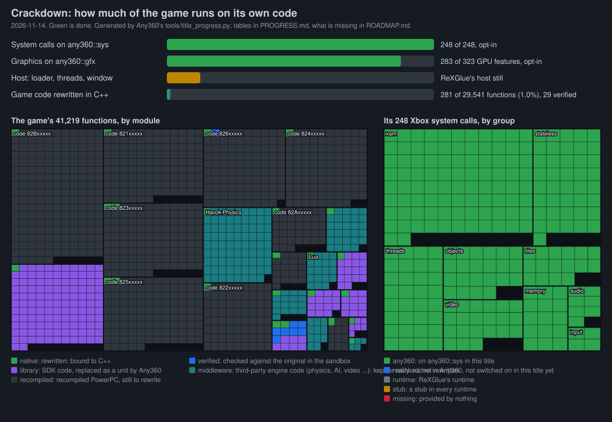

# Crackdown: rewrite progress

Generated on 2026-11-13 by [Any360](https://github.com/GaetanVigner/Any360)'s `tools/title_progress.py`. What is still missing, step by step: [ROADMAP.md](ROADMAP.md). Every function: [functions.csv](functions.csv). Counts: [progress.json](progress.json).

## Where it stands

| Axis | Done | Of | Share | Notes |
|---|---|---|---|---|
| System calls on `any360::sys` | 248 | 248 | 100% | all eight groups, opt-in on `main`: `--any360_sys_groups=stateless,files,objects,threads,memory,xam,input,audio`; no call reaches ReXGlue's kernel then |
| Graphics on `any360::gfx` (GPU features Any360 handles) | 283 | 323 | 88% | opt-in on `main`: `--any360_gpu=true` (resolution scale, host MSAA, pipeline cache); 160-220 FPS at 1440p with 4x MSAA in the city on an RTX 5070 Ti |
| Host (XEX loader, address space, threads, window, input, audio output) | 0 | 2 | 0% | ReXGlue's host runs the title; Any360 steps 13 and 14 |
| Game functions rewritten in C++ | 281 | 29,541 | 1.0% | 29 more verified against the original in the sandbox |
| Library functions (SDK, middleware) replaced | 131 | 6,377 | 2.1% | replaced as units, not decompiled |
| Middleware functions (third-party physics, AI, scripting, video) | - | 5,301 | - | kept recompiled or relinked from the vendor's library, not rewritten |
| Instructions of rewritten functions | 34,314 | 2,667,844 | 1.3% | PowerPC instructions of the original |

## System calls

The 248 kernel and XAM functions the title imports, by the group a title switches to `any360::sys` at once. **any360**: on any360::sys in this title. **ready**: native in Any360, not switched on in this title yet. **runtime**: ReXGlue's runtime. **stub**: a stub in every runtime. **missing**: provided by nothing.

| Group | any360 | ready | runtime | stub | missing | Total |
|---|---|---|---|---|---|---|
| stateless | 41 | 0 | 0 | 0 | 0 | 41 |
| files | 16 | 0 | 0 | 0 | 0 | 16 |
| objects | 22 | 0 | 0 | 0 | 0 | 22 |
| threads | 32 | 0 | 0 | 0 | 0 | 32 |
| memory | 15 | 0 | 0 | 0 | 0 | 15 |
| xam | 90 | 0 | 0 | 0 | 0 | 90 |
| input | 4 | 0 | 0 | 0 | 0 | 4 |
| audio | 7 | 0 | 0 | 0 | 0 | 7 |
| video | 21 | 0 | 0 | 0 | 0 | 21 |

Every call

| Group | Library | Function | State |
|---|---|---|---|
| stateless | xboxkrnl | `DbgBreakPoint` | any360 |
| stateless | xboxkrnl | `DbgPrint` | any360 |
| stateless | xboxkrnl | `ExGetXConfigSetting` | any360 |
| stateless | xboxkrnl | `KeBugCheck` | any360 |
| stateless | xboxkrnl | `KeBugCheckEx` | any360 |
| stateless | xboxkrnl | `KeEnableFpuExceptions` | any360 |
| stateless | xboxkrnl | `RtlCaptureContext` | any360 |
| stateless | xboxkrnl | `RtlCompareMemoryUlong` | any360 |
| stateless | xboxkrnl | `RtlFillMemoryUlong` | any360 |
| stateless | xboxkrnl | `RtlImageXexHeaderField` | any360 |
| stateless | xboxkrnl | `RtlInitAnsiString` | any360 |
| stateless | xboxkrnl | `RtlInitUnicodeString` | any360 |
| stateless | xboxkrnl | `RtlMultiByteToUnicodeN` | any360 |
| stateless | xboxkrnl | `RtlNtStatusToDosError` | any360 |
| stateless | xboxkrnl | `RtlRaiseException` | any360 |
| stateless | xboxkrnl | `RtlTimeFieldsToTime` | any360 |
| stateless | xboxkrnl | `RtlTimeToTimeFields` | any360 |
| stateless | xboxkrnl | `RtlUnicodeToMultiByteN` | any360 |
| stateless | xboxkrnl | `RtlUnwind` | any360 |
| stateless | xam | `XGetAVPack` | any360 |
| stateless | xam | `XGetGameRegion` | any360 |
| stateless | xam | `XGetLanguage` | any360 |
| stateless | xam | `XamGetExecutionId` | any360 |
| stateless | xam | `XamGetSystemVersion` | any360 |
| stateless | xam | `XamVoiceClose` | any360 |
| stateless | xam | `XamVoiceCreate` | any360 |
| stateless | xam | `XamVoiceHeadsetPresent` | any360 |
| stateless | xam | `XamVoiceSubmitPacket` | any360 |
| stateless | xboxkrnl | `XeCryptBnQwBeSigVerify` | any360 |
| stateless | xboxkrnl | `XeCryptRotSumSha` | any360 |
| stateless | xboxkrnl | `XeCryptSha` | any360 |
| stateless | xboxkrnl | `XeKeysConsolePrivateKeySign` | any360 |
| stateless | xboxkrnl | `XeKeysConsoleSignatureVerification` | any360 |
| stateless | xboxkrnl | `XeKeysGetKey` | any360 |
| stateless | xboxkrnl | `__C_specific_handler` | any360 |
| stateless | xboxkrnl | `_snwprintf` | any360 |
| stateless | xboxkrnl | `_vscwprintf` | any360 |
| stateless | xboxkrnl | `_vsnprintf` | any360 |
| stateless | xboxkrnl | `sprintf` | any360 |
| stateless | xboxkrnl | `swprintf` | any360 |
| stateless | xboxkrnl | `vswprintf` | any360 |
| files | xboxkrnl | `IoDismountVolumeByFileHandle` | any360 |
| files | xboxkrnl | `NtCreateFile` | any360 |
| files | xboxkrnl | `NtDeviceIoControlFile` | any360 |
| files | xboxkrnl | `NtFlushBuffersFile` | any360 |
| files | xboxkrnl | `NtOpenFile` | any360 |
| files | xboxkrnl | `NtQueryDirectoryFile` | any360 |
| files | xboxkrnl | `NtQueryFullAttributesFile` | any360 |
| files | xboxkrnl | `NtQueryInformationFile` | any360 |
| files | xboxkrnl | `NtQueryVolumeInformationFile` | any360 |
| files | xboxkrnl | `NtReadFile` | any360 |
| files | xboxkrnl | `NtSetInformationFile` | any360 |
| files | xboxkrnl | `NtWriteFile` | any360 |
| files | xboxkrnl | `ObCreateSymbolicLink` | any360 |
| files | xboxkrnl | `ObDeleteSymbolicLink` | any360 |
| files | xboxkrnl | `StfsControlDevice` | any360 |
| files | xboxkrnl | `StfsCreateDevice` | any360 |
| objects | xboxkrnl | `KeInitializeSemaphore` | any360 |
| objects | xboxkrnl | `KeReleaseSemaphore` | any360 |
| objects | xboxkrnl | `KeResetEvent` | any360 |
| objects | xboxkrnl | `KeSetEvent` | any360 |
| objects | xboxkrnl | `KeWaitForMultipleObjects` | any360 |
| objects | xboxkrnl | `KeWaitForSingleObject` | any360 |
| objects | xboxkrnl | `NtCancelTimer` | any360 |
| objects | xboxkrnl | `NtClearEvent` | any360 |
| objects | xboxkrnl | `NtClose` | any360 |
| objects | xboxkrnl | `NtCreateEvent` | any360 |
| objects | xboxkrnl | `NtCreateMutant` | any360 |
| objects | xboxkrnl | `NtCreateSemaphore` | any360 |
| objects | xboxkrnl | `NtCreateTimer` | any360 |
| objects | xboxkrnl | `NtDuplicateObject` | any360 |
| objects | xboxkrnl | `NtReleaseMutant` | any360 |
| objects | xboxkrnl | `NtReleaseSemaphore` | any360 |
| objects | xboxkrnl | `NtSetEvent` | any360 |
| objects | xboxkrnl | `NtSetTimerEx` | any360 |
| objects | xboxkrnl | `NtWaitForMultipleObjectsEx` | any360 |
| objects | xboxkrnl | `NtWaitForSingleObjectEx` | any360 |
| objects | xboxkrnl | `ObDereferenceObject` | any360 |
| objects | xboxkrnl | `ObReferenceObjectByHandle` | any360 |
| threads | xboxkrnl | `ExCreateThread` | any360 |
| threads | xboxkrnl | `ExTerminateThread` | any360 |
| threads | xboxkrnl | `HalReturnToFirmware` | any360 |
| threads | xboxkrnl | `KeAcquireSpinLockAtRaisedIrql` | any360 |
| threads | xboxkrnl | `KeDelayExecutionThread` | any360 |
| threads | xboxkrnl | `KeEnterCriticalRegion` | any360 |
| threads | xboxkrnl | `KeGetCurrentProcessType` | any360 |
| threads | xboxkrnl | `KeLeaveCriticalRegion` | any360 |
| threads | xboxkrnl | `KeQueryPerformanceFrequency` | any360 |
| threads | xboxkrnl | `KeQuerySystemTime` | any360 |
| threads | xboxkrnl | `KeRaiseIrqlToDpcLevel` | any360 |
| threads | xboxkrnl | `KeReleaseSpinLockFromRaisedIrql` | any360 |
| threads | xboxkrnl | `KeRestoreFloatingPointState` | any360 |
| threads | xboxkrnl | `KeResumeThread` | any360 |
| threads | xboxkrnl | `KeSaveFloatingPointState` | any360 |
| threads | xboxkrnl | `KeSetAffinityThread` | any360 |
| threads | xboxkrnl | `KeSetBasePriorityThread` | any360 |
| threads | xboxkrnl | `KeTlsAlloc` | any360 |
| threads | xboxkrnl | `KeTlsFree` | any360 |
| threads | xboxkrnl | `KeTlsGetValue` | any360 |
| threads | xboxkrnl | `KeTlsSetValue` | any360 |
| threads | xboxkrnl | `KfAcquireSpinLock` | any360 |
| threads | xboxkrnl | `KfLowerIrql` | any360 |
| threads | xboxkrnl | `KfReleaseSpinLock` | any360 |
| threads | xboxkrnl | `KiApcNormalRoutineNop` | any360 |
| threads | xboxkrnl | `NtResumeThread` | any360 |
| threads | xboxkrnl | `NtSuspendThread` | any360 |
| threads | xboxkrnl | `RtlEnterCriticalSection` | any360 |
| threads | xboxkrnl | `RtlInitializeCriticalSection` | any360 |
| threads | xboxkrnl | `RtlInitializeCriticalSectionAndSpinCount` | any360 |
| threads | xboxkrnl | `RtlLeaveCriticalSection` | any360 |
| threads | xboxkrnl | `RtlTryEnterCriticalSection` | any360 |
| memory | xboxkrnl | `KeLockL2` | any360 |
| memory | xboxkrnl | `KeUnlockL2` | any360 |
| memory | xboxkrnl | `MmAllocatePhysicalMemoryEx` | any360 |
| memory | xboxkrnl | `MmFreePhysicalMemory` | any360 |
| memory | xboxkrnl | `MmGetPhysicalAddress` | any360 |
| memory | xboxkrnl | `MmQueryAddressProtect` | any360 |
| memory | xboxkrnl | `MmQueryStatistics` | any360 |
| memory | xboxkrnl | `MmSetAddressProtect` | any360 |
| memory | xboxkrnl | `NtAllocateVirtualMemory` | any360 |
| memory | xboxkrnl | `NtFreeVirtualMemory` | any360 |
| memory | xboxkrnl | `NtQueryVirtualMemory` | any360 |
| memory | xboxkrnl | `RtlFreeAnsiString` | any360 |
| memory | xboxkrnl | `RtlUnicodeStringToAnsiString` | any360 |
| memory | xam | `XamAlloc` | any360 |
| memory | xam | `XamFree` | any360 |
| xam | xboxkrnl | `ExRegisterTitleTerminateNotification` | any360 |
| xam | xam | `NetDll_WSACloseEvent` | any360 |
| xam | xam | `NetDll_WSACreateEvent` | any360 |
| xam | xam | `NetDll_WSAEventSelect` | any360 |
| xam | xam | `NetDll_WSAGetLastError` | any360 |
| xam | xam | `NetDll_WSAStartup` | any360 |
| xam | xam | `NetDll_WSAWaitForMultipleEvents` | any360 |
| xam | xam | `NetDll_XNetConnect` | any360 |
| xam | xam | `NetDll_XNetCreateKey` | any360 |
| xam | xam | `NetDll_XNetGetConnectStatus` | any360 |
| xam | xam | `NetDll_XNetGetTitleXnAddr` | any360 |
| xam | xam | `NetDll_XNetInAddrToString` | any360 |
| xam | xam | `NetDll_XNetInAddrToXnAddr` | any360 |
| xam | xam | `NetDll_XNetQosListen` | any360 |
| xam | xam | `NetDll_XNetQosLookup` | any360 |
| xam | xam | `NetDll_XNetQosRelease` | any360 |
| xam | xam | `NetDll_XNetRandom` | any360 |
| xam | xam | `NetDll_XNetRegisterKey` | any360 |
| xam | xam | `NetDll_XNetServerToInAddr` | any360 |
| xam | xam | `NetDll_XNetStartup` | any360 |
| xam | xam | `NetDll_XNetUnregisterKey` | any360 |
| xam | xam | `NetDll_XNetXnAddrToInAddr` | any360 |
| xam | xam | `NetDll___WSAFDIsSet` | any360 |
| xam | xam | `NetDll_accept` | any360 |
| xam | xam | `NetDll_bind` | any360 |
| xam | xam | `NetDll_closesocket` | any360 |
| xam | xam | `NetDll_connect` | any360 |
| xam | xam | `NetDll_getpeername` | any360 |
| xam | xam | `NetDll_getsockname` | any360 |
| xam | xam | `NetDll_getsockopt` | any360 |
| xam | xam | `NetDll_inet_addr` | any360 |
| xam | xam | `NetDll_ioctlsocket` | any360 |
| xam | xam | `NetDll_listen` | any360 |
| xam | xam | `NetDll_recv` | any360 |
| xam | xam | `NetDll_recvfrom` | any360 |
| xam | xam | `NetDll_select` | any360 |
| xam | xam | `NetDll_send` | any360 |
| xam | xam | `NetDll_sendto` | any360 |
| xam | xam | `NetDll_setsockopt` | any360 |
| xam | xam | `NetDll_shutdown` | any360 |
| xam | xam | `NetDll_socket` | any360 |
| xam | xam | `XMsgCancelIORequest` | any360 |
| xam | xam | `XMsgInProcessCall` | any360 |
| xam | xam | `XMsgStartIORequest` | any360 |
| xam | xam | `XMsgStartIORequestEx` | any360 |
| xam | xam | `XNetLogonGetTitleID` | any360 |
| xam | xam | `XNotifyGetNext` | any360 |
| xam | xam | `XamContentClose` | any360 |
| xam | xam | `XamContentCreateEnumerator` | any360 |
| xam | xam | `XamContentCreateEx` | any360 |
| xam | xam | `XamContentDelete` | any360 |
| xam | xam | `XamContentGetDeviceState` | any360 |
| xam | xam | `XamContentLaunchImage` | any360 |
| xam | xam | `XamCreateEnumeratorHandle` | any360 |
| xam | xam | `XamEnumerate` | any360 |
| xam | xam | `XamGetPrivateEnumStructureFromHandle` | any360 |
| xam | xam | `XamLoaderLaunchTitle` | any360 |
| xam | xam | `XamLoaderSetLaunchData` | any360 |
| xam | xam | `XamLoaderTerminateTitle` | any360 |
| xam | xam | `XamNotifyCreateListener` | any360 |
| xam | xam | `XamParseGamerTileKey` | any360 |
| xam | xam | `XamReadTileToTexture` | any360 |
| xam | xam | `XamSessionCreateHandle` | any360 |
| xam | xam | `XamSessionRefObjByHandle` | any360 |
| xam | xam | `XamShowDeviceSelectorUI` | any360 |
| xam | xam | `XamShowFriendsUI` | any360 |
| xam | xam | `XamShowGamerCardUIForXUID` | any360 |
| xam | xam | `XamShowMarketplaceUI` | any360 |
| xam | xam | `XamShowMessageBoxUIEx` | any360 |
| xam | xam | `XamShowSigninUI` | any360 |
| xam | xam | `XamTaskCloseHandle` | any360 |
| xam | xam | `XamTaskSchedule` | any360 |
| xam | xam | `XamTaskShouldExit` | any360 |
| xam | xam | `XamUserAreUsersFriends` | any360 |
| xam | xam | `XamUserCheckPrivilege` | any360 |
| xam | xam | `XamUserCreateAchievementEnumerator` | any360 |
| xam | xam | `XamUserCreateStatsEnumerator` | any360 |
| xam | xam | `XamUserGetMembershipTierFromXUID` | any360 |
| xam | xam | `XamUserGetName` | any360 |
| xam | xam | `XamUserGetOnlineCountryFromXUID` | any360 |
| xam | xam | `XamUserGetSigninState` | any360 |
| xam | xam | `XamUserGetXUID` | any360 |
| xam | xam | `XamUserReadProfileSettings` | any360 |
| xam | xam | `XamUserWriteProfileSettings` | any360 |
| xam | xboxkrnl | `XexCheckExecutablePrivilege` | any360 |
| xam | xboxkrnl | `XexGetModuleHandle` | any360 |
| xam | xboxkrnl | `XexGetModuleSection` | any360 |
| xam | xboxkrnl | `XexGetProcedureAddress` | any360 |
| xam | xboxkrnl | `XexLoadImage` | any360 |
| xam | xboxkrnl | `XexUnloadImage` | any360 |
| input | xam | `XamInputGetCapabilities` | any360 |
| input | xam | `XamInputGetKeystrokeEx` | any360 |
| input | xam | `XamInputGetState` | any360 |
| input | xam | `XamInputSetState` | any360 |
| audio | xboxkrnl | `XAudioGetVoiceCategoryVolume` | any360 |
| audio | xboxkrnl | `XAudioGetVoiceCategoryVolumeChangeMask` | any360 |
| audio | xboxkrnl | `XAudioRegisterRenderDriverClient` | any360 |
| audio | xboxkrnl | `XAudioSubmitRenderDriverFrame` | any360 |
| audio | xboxkrnl | `XAudioUnregisterRenderDriverClient` | any360 |
| audio | xboxkrnl | `XMACreateContext` | any360 |
| audio | xboxkrnl | `XMAReleaseContext` | any360 |
| video | xboxkrnl | `VdCallGraphicsNotificationRoutines` | any360 |
| video | xboxkrnl | `VdEnableDisableClockGating` | any360 |
| video | xboxkrnl | `VdEnableRingBufferRPtrWriteBack` | any360 |
| video | xboxkrnl | `VdGetCurrentDisplayGamma` | any360 |
| video | xboxkrnl | `VdGetCurrentDisplayInformation` | any360 |
| video | xboxkrnl | `VdGetSystemCommandBuffer` | any360 |
| video | xboxkrnl | `VdInitializeEngines` | any360 |
| video | xboxkrnl | `VdInitializeRingBuffer` | any360 |
| video | xboxkrnl | `VdInitializeScalerCommandBuffer` | any360 |
| video | xboxkrnl | `VdIsHSIOTrainingSucceeded` | any360 |
| video | xboxkrnl | `VdPersistDisplay` | any360 |
| video | xboxkrnl | `VdQueryVideoFlags` | any360 |
| video | xboxkrnl | `VdQueryVideoMode` | any360 |
| video | xboxkrnl | `VdRetrainEDRAM` | any360 |
| video | xboxkrnl | `VdRetrainEDRAMWorker` | any360 |
| video | xboxkrnl | `VdSetDisplayMode` | any360 |
| video | xboxkrnl | `VdSetGraphicsInterruptCallback` | any360 |
| video | xboxkrnl | `VdSetSystemCommandBufferGpuIdentifierAddress` | any360 |
| video | xboxkrnl | `VdShutdownEngines` | any360 |
| video | xboxkrnl | `VdSwap` | any360 |
| video | xam | `XGetVideoMode` | any360 |

## Graphics

What `any360::gfx` handles of the Xbox 360 GPU (the same for every title; a title uses a part of it). In this title: opt-in on `main`: `--any360_gpu=true` (resolution scale, host MSAA, pipeline cache); 160-220 FPS at 1440p with 4x MSAA in the city on an RTX 5070 Ti.

| Family | Native | Not yet | Total |
|---|---|---|---|
| command processor | 43 | 7 | 50 |
| primitive types | 11 | 8 | 19 |
| render features | 54 | 1 | 55 |
| render target formats | 14 | 0 | 14 |
| shader ALU scalar | 50 | 0 | 50 |
| shader ALU vector | 30 | 0 | 30 |
| shader control flow | 16 | 0 | 16 |
| shader fetch | 9 | 0 | 9 |
| texture formats | 41 | 23 | 64 |
| vertex formats | 15 | 1 | 16 |

## Game code

Every function of the executable by module (named address ranges; the rest by 1 MB area until symbol recovery names them). **native**: rewritten: bound to C++. **verified**: checked against the original in the sandbox. **library**: SDK code, replaced as a unit by Any360. **middleware**: third-party engine code (physics, AI, video ...): kept or relinked, not rewritten. **recompiled**: recompiled PowerPC, still to rewrite.

| Module | Kind | Functions | Instructions | Native | Verified | Still recompiled | Native share |
|---|---|---|---|---|---|---|---|
| XDK D3DX and XGraphics (shader compiler) | library | 4,171 | 487,670 | 39 | 0 | 4,132 | 0.9% |
| code 825xxxxx | game | 3,839 | 259,174 | 51 | 0 | 3,788 | 1.3% |
| code 823xxxxx | game | 3,852 | 257,976 | 52 | 0 | 3,800 | 1.3% |
| code 824xxxxx | game | 3,353 | 257,848 | 47 | 0 | 3,306 | 1.4% |
| code 822xxxxx | game | 2,435 | 256,713 | 28 | 0 | 2,407 | 1.1% |
| code 826xxxxx | game | 3,366 | 223,024 | 24 | 29 | 3,313 | 0.7% |
| code 821xxxxx | game | 3,871 | 210,799 | 41 | 0 | 3,830 | 1.1% |
| Havok Physics | middleware | 2,699 | 191,551 | 25 | 0 | 2,674 | 0.9% |
| code 82Bxxxxx | game | 6,519 | 101,666 | 24 | 0 | 6,495 | 0.4% |
| code 82Axxxxx | game | 1,258 | 65,283 | 7 | 0 | 1,251 | 0.6% |
| Kynapse (AI) | middleware | 947 | 56,021 | 3 | 0 | 944 | 0.3% |
| SpeedTree | middleware | 560 | 42,091 | 10 | 0 | 550 | 1.8% |
| C runtime (CRT) | library | 595 | 41,901 | 24 | 0 | 571 | 4.0% |
| XDK D3D runtime | library | 553 | 34,977 | 48 | 252 | 253 | 8.7% |
| code 829xxxxx | game | 682 | 33,443 | 5 | 0 | 677 | 0.7% |
| Lua | middleware | 600 | 30,433 | 2 | 0 | 598 | 0.3% |
| XDK audio (XAudio, XMA) | library | 484 | 28,795 | 13 | 0 | 471 | 2.7% |
| code 827xxxxx | game | 366 | 25,239 | 2 | 0 | 364 | 0.5% |
| XDK Xbox Live and voice (XOnline, XHV) | library | 378 | 21,114 | 5 | 0 | 373 | 1.3% |
| Massive (in-game advertising) | middleware | 368 | 16,437 | 0 | 0 | 368 | 0% |
| Bink video | middleware | 127 | 16,392 | 1 | 0 | 126 | 0.8% |
| XAPI (Win32 layer over the kernel and XAM) | library | 194 | 9,291 | 2 | 0 | 192 | 1.0% |
| kernel import thunks | library | 2 | 6 | 0 | 0 | 2 | 0% |

The 453 rewritten functions

| Address | Module | Instructions | Handler | File |
|---|---|---|---|---|
| `8213BC38` | code 821xxxxx | 49 | `decomp::Sub_8213BC38` | decomp/leaf_batch1.cpp |
| `8213E3C8` | code 821xxxxx | 15 | `decomp::Sub_8213E3C8` | decomp/leaf_batch6.cpp |
| `8213F180` | code 821xxxxx | 10 | `decomp::Sub_8213F180` | decomp/leaf_batch3.cpp |
| `82140C90` | code 821xxxxx | 20 | `decomp::Sub_82140C90` | decomp/leaf_batch10.cpp |
| `82140CE0` | code 821xxxxx | 19 | `decomp::Sub_82140CE0` | decomp/leaf_batch9.cpp |
| `82144D80` | code 821xxxxx | 27 | `decomp::Sub_82144D80` | decomp/leaf_batch1.cpp |
| `82150C98` | code 821xxxxx | 22 | `decomp::Sub_82150C98` | decomp/leaf_batch12.cpp |
| `82150CF0` | code 821xxxxx | 21 | `decomp::Sub_82150CF0` | decomp/leaf_batch11.cpp |
| `821577C0` | code 821xxxxx | 17 | `decomp::Sub_821577C0` | decomp/leaf_batch7.cpp |
| `82157808` | code 821xxxxx | 30 | `decomp::Sub_82157808` | decomp/leaf_batch13.cpp |
| `82157A18` | code 821xxxxx | 17 | `decomp::Sub_82157A18` | decomp/leaf_batch8.cpp |
| `82157A60` | code 821xxxxx | 30 | `decomp::Sub_82157A60` | decomp/leaf_batch13.cpp |
| `821584B0` | code 821xxxxx | 17 | `decomp::Sub_821584B0` | decomp/leaf_batch8.cpp |
| `821584F8` | code 821xxxxx | 17 | `decomp::Sub_821584F8` | decomp/leaf_batch7.cpp |
| `82158540` | code 821xxxxx | 17 | `decomp::Sub_82158540` | decomp/leaf_batch8.cpp |
| `82158588` | code 821xxxxx | 17 | `decomp::Sub_82158588` | decomp/leaf_batch7.cpp |
| `8215A4A0` | code 821xxxxx | 20 | `decomp::Sub_8215A4A0` | decomp/leaf_batch9.cpp |
| `821681D0` | code 821xxxxx | 13 | `decomp::Sub_821681D0` | decomp/leaf_batch4.cpp |
| `8216F470` | code 821xxxxx | 13 | `decomp::Sub_8216F470` | decomp/leaf_batch1.cpp |
| `8216F4E8` | code 821xxxxx | 14 | `decomp::Sub_8216F4E8` | decomp/leaf_batch5.cpp |
| `82172648` | code 821xxxxx | 30 | `decomp::Sub_82172648` | decomp/leaf_batch13.cpp |
| `82185E40` | code 821xxxxx | 16 | `decomp::Sub_82185E40` | decomp/leaf_batch6.cpp |
| `8218DC98` | code 821xxxxx | 15 | `decomp::Sub_8218DC98` | decomp/leaf_batch6.cpp |
| `8218DF60` | code 821xxxxx | 24 | `decomp::Sub_8218DF60` | decomp/leaf_batch12.cpp |
| `82199AA8` | code 821xxxxx | 20 | `decomp::Sub_82199AA8` | decomp/leaf_batch10.cpp |
| `8219A2C0` | code 821xxxxx | 22 | `decomp::Sub_8219A2C0` | decomp/leaf_batch12.cpp |
| `8219A318` | code 821xxxxx | 22 | `decomp::Sub_8219A318` | decomp/leaf_batch12.cpp |
| `8219D658` | code 821xxxxx | 30 | `decomp::Sub_8219D658` | decomp/leaf_batch13.cpp |
| `821A17C8` | code 821xxxxx | 21 | `decomp::Sub_821A17C8` | decomp/leaf_batch11.cpp |
| `821A9C00` | code 821xxxxx | 20 | `decomp::Sub_821A9C00` | decomp/leaf_batch10.cpp |
| `821AA050` | code 821xxxxx | 18 | `decomp::Sub_821AA050` | decomp/leaf_batch9.cpp |
| `821BC260` | code 821xxxxx | 21 | `decomp::Sub_821BC260` | decomp/leaf_batch11.cpp |
| `821BFCC0` | code 821xxxxx | 10 | `decomp::Sub_821BFCC0` | decomp/leaf_batch3.cpp |
| `821C5D38` | code 821xxxxx | 13 | `decomp::Sub_821C5D38` | decomp/leaf_batch4.cpp |
| `821C5D70` | code 821xxxxx | 13 | `decomp::Sub_821C5D70` | decomp/leaf_batch4.cpp |
| `821CAA40` | code 821xxxxx | 24 | `decomp::Sub_821CAA40` | decomp/leaf_batch1.cpp |
| `821E72D0` | code 821xxxxx | 16 | `decomp::Sub_821E72D0` | decomp/leaf_batch1.cpp |
| `821E8E90` | code 821xxxxx | 15 | `decomp::Sub_821E8E90` | decomp/leaf_batch1.cpp |
| `821F3320` | code 821xxxxx | 14 | `decomp::Sub_821F3320` | decomp/leaf_batch5.cpp |
| `821F39B0` | code 821xxxxx | 14 | `decomp::Sub_821F39B0` | decomp/leaf_batch5.cpp |
| `821F58D0` | code 821xxxxx | 10 | `decomp::Sub_821F58D0` | decomp/leaf_batch3.cpp |
| `82202068` | code 822xxxxx | 13 | `decomp::Sub_82202068` | decomp/leaf_batch4.cpp |
| `82213708` | code 822xxxxx | 35 | `decomp::Sub_82213708` | decomp/leaf_batch8.cpp |
| `82213798` | code 822xxxxx | 18 | `decomp::Sub_82213798` | decomp/leaf_batch6.cpp |
| `822137E0` | code 822xxxxx | 61 | `decomp::Sub_822137E0` | decomp/leaf_batch8.cpp |
| `82258550` | code 822xxxxx | 11 | `decomp::Sub_82258550` | decomp/leaf_batch3.cpp |
| `8225AB30` | code 822xxxxx | 349 | `WaveInstanceSetup` | audio_wave_timeout.cpp |
| `82270B80` | code 822xxxxx | 10 | `decomp::Sub_82270B80` | decomp/leaf_batch3.cpp |
| `82271AD8` | code 822xxxxx | 27 | `decomp::Sub_82271AD8` | decomp/leaf_batch7.cpp |
| `822846A0` | code 822xxxxx | 69 | `CameraConstructed` | aspect_render.cpp |
| `82284F58` | code 822xxxxx | 17 | `decomp::Sub_82284F58` | decomp/leaf_batch5.cpp |
| `82287130` | code 822xxxxx | 167 | `CameraUpdate` | nan_guards.cpp |
| `822979C8` | code 822xxxxx | 82 | `decomp::Sub_822979C8` | decomp/leaf_batch10.cpp |
| `822A38D0` | code 822xxxxx | 368 | `DamageEntry` | cheat_hooks.cpp |
| `822B7408` | code 822xxxxx | 39 | `decomp::Sub_822B7408` | decomp/leaf_batch1.cpp |
| `822C5EC8` | code 822xxxxx | 66 | `decomp::Sub_822C5EC8` | decomp/leaf_batch9.cpp |
| `822DEFD0` | code 822xxxxx | 73 | `decomp::Sub_822DEFD0` | decomp/leaf_batch9.cpp |
| `822E9A98` | code 822xxxxx | 17 | `decomp::Sub_822E9A98` | decomp/leaf_batch6.cpp |
| `822EB240` | code 822xxxxx | 16 | `decomp::Sub_822EB240` | decomp/leaf_batch5.cpp |
| `822EBBB0` | code 822xxxxx | 11 | `decomp::Sub_822EBBB0` | decomp/leaf_batch3.cpp |
| `822ECBC0` | code 822xxxxx | 13 | `decomp::Sub_822ECBC0` | decomp/leaf_batch4.cpp |
| `822ECED0` | code 822xxxxx | 188 | `JumpLaunch` | cheat_hooks.cpp |
| `822F0F08` | code 822xxxxx | 76 | `decomp::Sub_822F0F08` | decomp/leaf_batch9.cpp |
| `822F9AD8` | code 822xxxxx | 19 | `decomp::Sub_822F9AD8` | decomp/leaf_batch7.cpp |
| `822F9FA0` | code 822xxxxx | 19 | `decomp::Sub_822F9FA0` | decomp/leaf_batch6.cpp |
| `822FB238` | code 822xxxxx | 16 | `decomp::Sub_822FB238` | decomp/leaf_batch5.cpp |
| `822FC1A8` | code 822xxxxx | 29 | `decomp::Sub_822FC1A8` | decomp/leaf_batch8.cpp |
| `822FD2E8` | code 822xxxxx | 19 | `decomp::Sub_822FD2E8` | decomp/leaf_batch7.cpp |
| `822FE9F0` | code 822xxxxx | 15 | `decomp::Sub_822FE9F0` | decomp/leaf_batch4.cpp |
| `82302828` | code 823xxxxx | 37 | `decomp::Sub_82302828` | decomp/leaf_batch13.cpp |
| `82303670` | code 823xxxxx | 15 | `decomp::Sub_82303670` | decomp/leaf_batch6.cpp |
| `82305158` | code 823xxxxx | 13 | `decomp::Sub_82305158` | decomp/leaf_batch4.cpp |
| `82307B70` | code 823xxxxx | 20 | `decomp::Sub_82307B70` | decomp/leaf_batch9.cpp |
| `82308DE8` | code 823xxxxx | 32 | `decomp::Sub_82308DE8` | decomp/leaf_batch12.cpp |
| `82309F98` | code 823xxxxx | 19 | `decomp::Sub_82309F98` | decomp/leaf_batch9.cpp |
| `8230A578` | code 823xxxxx | 14 | `decomp::Sub_8230A578` | decomp/leaf_batch5.cpp |
| `8230E280` | code 823xxxxx | 16 | `decomp::Sub_8230E280` | decomp/leaf_batch7.cpp |
| `8230EE50` | code 823xxxxx | 13 | `decomp::Sub_8230EE50` | decomp/leaf_batch4.cpp |
| `82311448` | code 823xxxxx | 10 | `decomp::Sub_82311448` | decomp/leaf_batch3.cpp |
| `82312AB8` | code 823xxxxx | 25 | `decomp::Sub_82312AB8` | decomp/leaf_batch11.cpp |
| `823137F8` | code 823xxxxx | 24 | `decomp::Sub_823137F8` | decomp/leaf_batch11.cpp |
| `82314E50` | code 823xxxxx | 19 | `decomp::Sub_82314E50` | decomp/leaf_batch8.cpp |
| `82315270` | code 823xxxxx | 22 | `decomp::Sub_82315270` | decomp/leaf_batch11.cpp |
| `82315780` | code 823xxxxx | 32 | `decomp::Sub_82315780` | decomp/leaf_batch12.cpp |
| `823159A0` | code 823xxxxx | 21 | `decomp::Sub_823159A0` | decomp/leaf_batch10.cpp |
| `82315B78` | code 823xxxxx | 38 | `decomp::Sub_82315B78` | decomp/leaf_batch13.cpp |
| `82315CE0` | code 823xxxxx | 14 | `decomp::Sub_82315CE0` | decomp/leaf_batch5.cpp |
| `82315E00` | code 823xxxxx | 13 | `decomp::Sub_82315E00` | decomp/leaf_batch4.cpp |
| `82316328` | code 823xxxxx | 17 | `decomp::Sub_82316328` | decomp/leaf_batch8.cpp |
| `82324938` | code 823xxxxx | 65 | `TimingUpdate` | frame_pacing.cpp |
| `82326300` | code 823xxxxx | 10 | `decomp::Sub_82326300` | decomp/leaf_batch3.cpp |
| `82326348` | code 823xxxxx | 36 | `decomp::Sub_82326348` | decomp/leaf_batch13.cpp |
| `823263D8` | code 823xxxxx | 82 | `FrameTimer` | frame_pacing.cpp |
| `82326728` | code 823xxxxx | 67 | `SceneTargetsCreate` | single_tile_scene.cpp |
| `8232AD48` | code 823xxxxx | 20 | `decomp::Sub_8232AD48` | decomp/leaf_batch10.cpp |
| `8232AD98` | code 823xxxxx | 20 | `decomp::Sub_8232AD98` | decomp/leaf_batch9.cpp |
| `8232EFB0` | code 823xxxxx | 16 | `decomp::Sub_8232EFB0` | decomp/leaf_batch7.cpp |
| `82340008` | code 823xxxxx | 114 | `decomp::Sub_82340008` | decomp/leaf_batch2.cpp |
| `82351F60` | code 823xxxxx | 411 | `RenderPass18` | guest_bindings_base.cpp |
| `823597F8` | code 823xxxxx | 293 | `FireWeaponTracked` | cheat_hooks.cpp |
| `8235D570` | code 823xxxxx | 308 | `FireWeaponTracked` | cheat_hooks.cpp |
| `82369348` | code 823xxxxx | 10 | `decomp::Sub_82369348` | decomp/leaf_batch3.cpp |
| `823819A0` | code 823xxxxx | 34 | `ApplyLanguage` | title_language.cpp |
| `82381F28` | code 823xxxxx | 51 | `MenuStringById` | main_menu_quit.cpp |
| `82391118` | code 823xxxxx | 33 | `decomp::Sub_82391118` | decomp/leaf_batch13.cpp |
| `823925C0` | code 823xxxxx | 72 | `decomp::Sub_823925C0` | decomp/leaf_batch2.cpp |
| `823A41D8` | code 823xxxxx | 27 | `decomp::Sub_823A41D8` | decomp/leaf_batch12.cpp |
| `823A4248` | code 823xxxxx | 30 | `decomp::Sub_823A4248` | decomp/leaf_batch12.cpp |
| `823B4F20` | code 823xxxxx | 107 | `RenderObjects` | hle_capture.cpp |
| `823B7838` | code 823xxxxx | 62 | `decomp::Sub_823B7838` | decomp/leaf_batch2.cpp |
| `823BA308` | code 823xxxxx | 56 | `RenderObjects` | hle_capture.cpp |
| `823CA8F0` | code 823xxxxx | 15 | `decomp::Sub_823CA8F0` | decomp/leaf_batch6.cpp |
| `823CAA10` | code 823xxxxx | 15 | `decomp::Sub_823CAA10` | decomp/leaf_batch6.cpp |
| `823CD950` | code 823xxxxx | 16 | `decomp::Sub_823CD950` | decomp/leaf_batch7.cpp |
| `823D19A8` | code 823xxxxx | 17 | `decomp::Sub_823D19A8` | decomp/leaf_batch8.cpp |
| `823E9490` | code 823xxxxx | 154 | `OrbListDescriptorShown` | orb_map.cpp |
| `823E96F8` | code 823xxxxx | 27 | `OrbListDescriptorPosition` | orb_map.cpp |
| `823E9BD0` | code 823xxxxx | 23 | `decomp::Sub_823E9BD0` | decomp/leaf_batch1.cpp |
| `823E9C30` | code 823xxxxx | 225 | `OrbMinimapProjection` | orb_map.cpp |
| `823EA600` | code 823xxxxx | 22 | `decomp::Sub_823EA600` | decomp/leaf_batch10.cpp |
| `823FA9A8` | code 823xxxxx | 14 | `decomp::Sub_823FA9A8` | decomp/leaf_batch5.cpp |
| `824099B8` | code 824xxxxx | 447 | `RenderHud` | hle_capture.cpp |
| `8240A0B8` | code 824xxxxx | 255 | `RenderHud` | hle_capture.cpp |
| `8240B648` | code 824xxxxx | 16 | `decomp::Sub_8240B648` | decomp/leaf_batch6.cpp |
| `8240B7B8` | code 824xxxxx | 20 | `decomp::Sub_8240B7B8` | decomp/leaf_batch7.cpp |
| `8240B8D0` | code 824xxxxx | 25 | `decomp::Sub_8240B8D0` | decomp/leaf_batch8.cpp |
| `8240BAC8` | code 824xxxxx | 30 | `decomp::Sub_8240BAC8` | decomp/leaf_batch11.cpp |
| `8240BC48` | code 824xxxxx | 27 | `decomp::Sub_8240BC48` | decomp/leaf_batch9.cpp |
| `8240C038` | code 824xxxxx | 30 | `decomp::Sub_8240C038` | decomp/leaf_batch10.cpp |
| `8241BDB8` | code 824xxxxx | 36 | `decomp::Sub_8241BDB8` | decomp/leaf_batch12.cpp |
| `8241F868` | code 824xxxxx | 37 | `decomp::Sub_8241F868` | decomp/leaf_batch12.cpp |
| `82445008` | code 824xxxxx | 31 | `decomp::Sub_82445008` | decomp/leaf_batch11.cpp |
| `82462D98` | code 824xxxxx | 49 | `decomp::Sub_82462D98` | decomp/leaf_batch13.cpp |
| `82462E60` | code 824xxxxx | 49 | `decomp::Sub_82462E60` | decomp/leaf_batch13.cpp |
| `82463160` | code 824xxxxx | 94 | `decomp::Sub_82463160` | decomp/leaf_batch2.cpp |
| `8246DAE0` | code 824xxxxx | 67 | `decomp::Sub_8246DAE0` | decomp/leaf_batch2.cpp |
| `82471460` | code 824xxxxx | 45 | `decomp::Sub_82471460` | decomp/leaf_batch13.cpp |
| `82473790` | code 824xxxxx | 14 | `decomp::Sub_82473790` | decomp/leaf_batch5.cpp |
| `82474118` | code 824xxxxx | 22 | `decomp::Sub_82474118` | decomp/leaf_batch8.cpp |
| `824748B0` | code 824xxxxx | 13 | `decomp::Sub_824748B0` | decomp/leaf_batch4.cpp |
| `82474CA8` | code 824xxxxx | 13 | `decomp::Sub_82474CA8` | decomp/leaf_batch4.cpp |
| `82474CE0` | code 824xxxxx | 18 | `decomp::Sub_82474CE0` | decomp/leaf_batch7.cpp |
| `82475DD0` | code 824xxxxx | 28 | `decomp::Sub_82475DD0` | decomp/leaf_batch9.cpp |
| `82476C50` | code 824xxxxx | 18 | `decomp::Sub_82476C50` | decomp/leaf_batch6.cpp |
| `82477E88` | code 824xxxxx | 18 | `decomp::Sub_82477E88` | decomp/leaf_batch7.cpp |
| `82479668` | code 824xxxxx | 15 | `decomp::Sub_82479668` | decomp/leaf_batch5.cpp |
| `8247A720` | code 824xxxxx | 28 | `decomp::Sub_8247A720` | decomp/leaf_batch10.cpp |
| `82481B08` | code 824xxxxx | 29 | `decomp::Sub_82481B08` | decomp/leaf_batch10.cpp |
| `824879B8` | code 824xxxxx | 10 | `decomp::Sub_824879B8` | decomp/leaf_batch3.cpp |
| `824888C8` | code 824xxxxx | 10 | `decomp::Sub_824888C8` | decomp/leaf_batch3.cpp |
| `8249E760` | code 824xxxxx | 42 | `decomp::Sub_8249E760` | decomp/leaf_batch13.cpp |
| `8249E808` | code 824xxxxx | 248 | `EngineTorque` | cheat_hooks.cpp |
| `824A05D0` | code 824xxxxx | 40 | `decomp::Sub_824A05D0` | decomp/leaf_batch12.cpp |
| `824A1708` | code 824xxxxx | 165 | `VehicleAction` | vehicle_action_step.cpp |
| `824A3BC8` | code 824xxxxx | 31 | `decomp::Sub_824A3BC8` | decomp/leaf_batch11.cpp |
| `824ABED0` | code 824xxxxx | 69 | `decomp::Sub_824ABED0` | decomp/leaf_batch2.cpp |
| `824BB950` | code 824xxxxx | 152 | `VehicleDamage` | cheat_hooks.cpp |
| `824C1A10` | code 824xxxxx | 166 | `VehicleDamage` | cheat_hooks.cpp |
| `824C55E8` | code 824xxxxx | 22 | `decomp::Sub_824C55E8` | decomp/leaf_batch8.cpp |
| `824C9E08` | code 824xxxxx | 680 | `VehicleDamage` | cheat_hooks.cpp |
| `824D51B8` | code 824xxxxx | 315 | `VehicleDamage` | cheat_hooks.cpp |
| `824DA608` | code 824xxxxx | 77 | `decomp::Sub_824DA608` | decomp/leaf_batch2.cpp |
| `824DE458` | code 824xxxxx | 27 | `decomp::Sub_824DE458` | decomp/leaf_batch9.cpp |
| `824EC668` | code 824xxxxx | 31 | `EntityDestroyed` | entity_registry.cpp |
| `824EFD98` | code 824xxxxx | 51 | `OrbConstructed` | orb_map.cpp |
| `824EFE68` | code 824xxxxx | 39 | `OrbDestroyed` | orb_map.cpp |
| `824FC190` | code 824xxxxx | 661 | `WalkVelocity` | cheat_hooks.cpp |
| `824FD840` | code 824xxxxx | 489 | `AimUpdate` | nan_guards.cpp |
| `825065E0` | code 825xxxxx | 10 | `decomp::Sub_825065E0` | decomp/leaf_batch3.cpp |
| `8250ADE0` | code 825xxxxx | 18 | `decomp::Sub_8250ADE0` | decomp/leaf_batch7.cpp |
| `8250F0F0` | code 825xxxxx | 94 | `decomp::Sub_8250F0F0` | decomp/leaf_batch12.cpp |
| `825111A8` | code 825xxxxx | 22 | `decomp::Sub_825111A8` | decomp/leaf_batch7.cpp |
| `8251FA20` | code 825xxxxx | 50 | `RenderPass1` | guest_bindings_base.cpp |
| `82527AC8` | code 825xxxxx | 70 | `VehicleDamage` | cheat_hooks.cpp |
| `8253C118` | code 825xxxxx | 10 | `decomp::Sub_8253C118` | decomp/leaf_batch3.cpp |
| `8254C568` | code 825xxxxx | 33 | `FrameDelta` | frame_pacing.cpp |
| `82555B38` | code 825xxxxx | 43 | `decomp::Sub_82555B38` | decomp/leaf_batch9.cpp |
| `82568DE0` | code 825xxxxx | 102 | `RenderPass13` | guest_bindings_base.cpp |
| `82581CF8` | code 825xxxxx | 40 | `decomp::Sub_82581CF8` | decomp/leaf_batch8.cpp |
| `82581E18` | code 825xxxxx | 40 | `decomp::Sub_82581E18` | decomp/leaf_batch9.cpp |
| `82581ED0` | code 825xxxxx | 17 | `decomp::Sub_82581ED0` | decomp/leaf_batch6.cpp |
| `82586538` | code 825xxxxx | 88 | `decomp::Sub_82586538` | decomp/leaf_batch11.cpp |
| `82587D30` | code 825xxxxx | 82 | `decomp::Sub_82587D30` | decomp/leaf_batch11.cpp |
| `8258AEA8` | code 825xxxxx | 15 | `decomp::Sub_8258AEA8` | decomp/leaf_batch4.cpp |
| `8258C098` | code 825xxxxx | 51 | `decomp::Sub_8258C098` | decomp/leaf_batch10.cpp |
| `82597840` | code 825xxxxx | 17 | `decomp::Sub_82597840` | decomp/leaf_batch6.cpp |
| `8259FD50` | code 825xxxxx | 27 | `decomp::Sub_8259FD50` | decomp/leaf_batch8.cpp |
| `825A7068` | code 825xxxxx | 44 | `decomp::Sub_825A7068` | decomp/leaf_batch9.cpp |
| `825A76E0` | code 825xxxxx | 966 | `PostProcessConstructed` | single_tile_scene.cpp |
| `825A8AA0` | code 825xxxxx | 124 | `RenderPass16` | guest_bindings_base.cpp |
| `825A8C90` | code 825xxxxx | 511 | `RenderPass9` | guest_bindings_base.cpp |
| `825A9490` | code 825xxxxx | 254 | `RenderPass15` | guest_bindings_base.cpp |
| `825A9A80` | code 825xxxxx | 104 | `RenderPass25` | guest_bindings_base.cpp |
| `825A9C20` | code 825xxxxx | 52 | `RenderPass6` | guest_bindings_base.cpp |
| `825A9CF0` | code 825xxxxx | 99 | `RenderPass7` | guest_bindings_base.cpp |
| `825A9E80` | code 825xxxxx | 98 | `RenderPass8` | guest_bindings_base.cpp |
| `825AA490` | code 825xxxxx | 285 | `RenderPass20` | guest_bindings_base.cpp |
| `825AD5F0` | code 825xxxxx | 688 | `RenderPass12` | guest_bindings_base.cpp |
| `825B1950` | code 825xxxxx | 251 | `RenderPass24` | guest_bindings_base.cpp |
| `825B4718` | code 825xxxxx | 282 | `RenderPass11` | guest_bindings_base.cpp |
| `825B5728` | code 825xxxxx | 998 | `RenderPass23` | guest_bindings_base.cpp |
| `825B7930` | code 825xxxxx | 785 | `RenderPass21` | guest_bindings_base.cpp |
| `825BA9F8` | code 825xxxxx | 207 | `RenderPass22` | guest_bindings_base.cpp |
| `825BFA18` | code 825xxxxx | 14 | `decomp::Sub_825BFA18` | decomp/leaf_batch4.cpp |
| `825C80D0` | code 825xxxxx | 398 | `RenderPass5` | guest_bindings_base.cpp |
| `825CB478` | code 825xxxxx | 79 | `RenderPass17` | guest_bindings_base.cpp |
| `825D1EC0` | code 825xxxxx | 1549 | `RenderPass14` | guest_bindings_base.cpp |
| `825D3808` | code 825xxxxx | 16 | `decomp::Sub_825D3808` | decomp/leaf_batch5.cpp |
| `825D3910` | code 825xxxxx | 432 | `RenderPass2` | guest_bindings_base.cpp |
| `825D8258` | code 825xxxxx | 915 | `RenderPass10` | guest_bindings_base.cpp |
| `825DBD98` | code 825xxxxx | 637 | `RenderPass3` | guest_bindings_base.cpp |
| `825DC790` | code 825xxxxx | 231 | `RenderPass4` | guest_bindings_base.cpp |
| `825DD2B0` | code 825xxxxx | 57 | `decomp::Sub_825DD2B0` | decomp/leaf_batch10.cpp |
| `825DD398` | code 825xxxxx | 62 | `decomp::Sub_825DD398` | decomp/leaf_batch11.cpp |
| `825E12F8` | code 825xxxxx | 346 | `RenderPass19` | guest_bindings_base.cpp |
| `825F1890` | code 825xxxxx | 59 | `decomp::Sub_825F1890` | decomp/leaf_batch10.cpp |
| `825F6CC8` | code 825xxxxx | 16 | `decomp::Sub_825F6CC8` | decomp/leaf_batch5.cpp |
| `825FBDB8` | code 825xxxxx | 37 | `decomp::Sub_825FBDB8` | decomp/leaf_batch8.cpp |
| `825FF080` | code 825xxxxx | 51 | `decomp::Sub_825FF080` | decomp/leaf_batch2.cpp |
| `826011F8` | code 826xxxxx | 54 | `decomp::Sub_826011F8` | decomp/leaf_batch6.cpp |
| `8261BCF8` | code 826xxxxx | 22 | `decomp::Sub_8261BCF8` | decomp/leaf_batch4.cpp |
| `82624A30` | code 826xxxxx | 35 | `PlayVideo` | skip_intro.cpp |
| `82626BE8` | code 826xxxxx | 40 | `decomp::Sub_82626BE8` | decomp/leaf_batch5.cpp |
| `82627528` | code 826xxxxx | 30 | `OrbFrontendScreenConstructed` | orb_map.cpp |
| `82627640` | code 826xxxxx | 23 | `OrbFrontendScreenDestroyed` | orb_map.cpp |
| `826400D8` | code 826xxxxx | 579 | `OrbMapViewConstructed` | orb_map.cpp |
| `82640A50` | code 826xxxxx | 179 | `OrbMapViewDestroyed` | orb_map.cpp |
| `8264FAA0` | code 826xxxxx | 39 | `decomp::Sub_8264FAA0` | decomp/leaf_batch4.cpp |
| `82652B30` | code 826xxxxx | 43 | `decomp::Sub_82652B30` | decomp/leaf_batch6.cpp |
| `82653FC0` | code 826xxxxx | 189 | `SequenceFrame` | skip_intro.cpp |
| `82658560` | code 826xxxxx | 29 | `MenuPopupDestroyed` | main_menu_quit.cpp |
| `826586B0` | code 826xxxxx | 11 | `MenuPopupNo` | main_menu_quit.cpp |
| `826587F8` | code 826xxxxx | 39 | `MenuPopupYes` | main_menu_quit.cpp |
| `8265CDC8` | code 826xxxxx | 10 | `decomp::Sub_8265CDC8` | decomp/leaf_batch3.cpp |
| `82677CB8` | code 826xxxxx | 29 | `MenuBlockDestroyed` | main_menu_quit.cpp |
| `82678768` | code 826xxxxx | 17 | `MenuPopupOpen` | main_menu_quit.cpp |
| `82694200` | code 826xxxxx | 40 | `decomp::Sub_82694200` | decomp/leaf_batch5.cpp |
| `8269A9D8` | code 826xxxxx | 3 | `OrbFrontendScreenDestroyed` | orb_map.cpp |
| `8269B3C8` | code 826xxxxx | 10 | `decomp::Sub_8269B3C8` | decomp/leaf_batch3.cpp |
| `826A6B50` | code 826xxxxx | 70 | `SimulationUpdate` | frame_pacing.cpp |
| `826A7698` | code 826xxxxx | 172 | `FrameLoop` | frame_pacing.cpp |
| `826A8940` | code 826xxxxx | 71 | `EngineMovie` | skip_intro.cpp |
| `826AED90` | XDK D3D runtime | 92 | `D3dCreateRenderTarget` | single_tile_scene.cpp |
| `826AF038` | XDK D3D runtime | 94 | `D3dState` | guest_bindings_base.cpp |
| `826AF950` | XDK D3D runtime | 32 | `D3dState` | guest_bindings_base.cpp |
| `826AF9E0` | XDK D3D runtime | 31 | `D3dState` | guest_bindings_base.cpp |
| `826AFA70` | XDK D3D runtime | 31 | `D3dState` | guest_bindings_base.cpp |
| `826AFB00` | XDK D3D runtime | 31 | `D3dState` | guest_bindings_base.cpp |
| `826AFB90` | XDK D3D runtime | 23 | `D3dState` | guest_bindings_base.cpp |
| `826AFC00` | XDK D3D runtime | 23 | `D3dState` | guest_bindings_base.cpp |
| `826AFC70` | XDK D3D runtime | 23 | `D3dState` | guest_bindings_base.cpp |
| `826AFCE0` | XDK D3D runtime | 33 | `D3dState` | guest_bindings_base.cpp |
| `826B1150` | XDK D3D runtime | 2 | `PresentInterval` | frame_pacing.cpp |
| `826B1180` | XDK D3D runtime | 48 | `D3dState` | guest_bindings_base.cpp |
| `826B1308` | XDK D3D runtime | 48 | `D3dState` | guest_bindings_base.cpp |
| `826B1D30` | XDK D3D runtime | 71 | `D3dState` | guest_bindings_base.cpp |
| `826B1E50` | XDK D3D runtime | 36 | `D3dState` | guest_bindings_base.cpp |
| `826B2F68` | XDK D3D runtime | 63 | `D3dSetShaderConstants` | crt_native.cpp |
| `826B3070` | XDK D3D runtime | 63 | `D3dState` | guest_bindings_base.cpp |
| `826B3178` | XDK D3D runtime | 23 | `D3dState` | guest_bindings_base.cpp |
| `826B31D8` | XDK D3D runtime | 23 | `D3dState` | guest_bindings_base.cpp |
| `826B3458` | XDK D3D runtime | 111 | `D3dState` | guest_bindings_base.cpp |
| `826B3848` | XDK D3D runtime | 115 | `D3dState` | guest_bindings_base.cpp |
| `826B3C48` | XDK D3D runtime | 115 | `D3dSetShaderGprAllocation` | hle_capture.cpp |
| `826B91E0` | XDK D3D runtime | 294 | `D3dBeginVertices` | hle_capture.cpp |
| `826B96D0` | XDK D3D runtime | 333 | `D3dBeginIndexedVertices` | hle_capture.cpp |
| `826B9C08` | XDK D3D runtime | 251 | `D3dDrawVertices` | hle_capture.cpp |
| `826B9FF8` | XDK D3D runtime | 279 | `D3dDrawIndexedVertices` | hle_capture.cpp |
| `826BB408` | XDK D3D runtime | 58 | `D3dRingSegmentSwitch` | hle_capture.cpp |
| `826BB4F0` | XDK D3D runtime | 53 | `GpuFence` | gpu_fence_wait.cpp |
| `826BBEE0` | XDK D3D runtime | 45 | `GpuPoll` | gpu_fence_wait.cpp |
| `826BC3D0` | XDK D3D runtime | 99 | `SwapCallback` | frame_pacing.cpp |
| `826BC568` | XDK D3D runtime | 103 | `SwapPacket` | frame_pacing.cpp |
| `826BCA98` | XDK D3D runtime | 455 | `SwapBuilder` | frame_rate.cpp |
| `826BD300` | XDK D3D runtime | 97 | `D3dSetPredication` | single_tile_scene.cpp |
| `826BD488` | XDK D3D runtime | 364 | `D3dBeginTiling` | single_tile_scene.cpp |
| `826BDA38` | XDK D3D runtime | 313 | `D3dEndTiling` | single_tile_scene.cpp |
| `826BE578` | XDK D3D runtime | 897 | `D3dResolve` | hle_capture.cpp |
| `826BFD88` | XDK D3D runtime | 406 | `ClearOrOriginal` | guest_bindings_base.cpp |
| `826C04A0` | XDK D3D runtime | 73 | `D3dClear` | hle_capture.cpp |
| `826C0B38` | XDK D3D runtime | 126 | `QueryIssueOrOriginal` | guest_bindings_base.cpp |
| `826C3750` | XDK D3D runtime | 400 | `D3dRunCommandBuffer` | hle_capture.cpp |
| `826C3D90` | XDK D3D runtime | 166 | `CommandBufferFixup` | single_tile_scene.cpp |
| `826C4C70` | XDK D3D runtime | 37 | `D3dState` | guest_bindings_base.cpp |
| `826C5768` | XDK D3D runtime | 229 | `FlushStateOrOriginal` | guest_bindings_base.cpp |
| `826C5B00` | XDK D3D runtime | 48 | `D3dDirtyWords` | crt_native.cpp |
| `826C5BC0` | XDK D3D runtime | 95 | `FlushWaitGroupOrOriginal` | guest_bindings_base.cpp |
| `826C5D40` | XDK D3D runtime | 88 | `FlushFetchConstantsOrOriginal` | guest_bindings_base.cpp |
| `826C5EA0` | XDK D3D runtime | 91 | `D3dDirtyConstants` | crt_native.cpp |
| `826C6A50` | XDK D3D runtime | 44 | `D3dBindShaderLiterals` | single_tile_scene.cpp |
| `826D5C28` | code 826xxxxx | 72 | `decomp::Sub_826D5C28` | decomp/leaf_batch7.cpp |
| `8270D108` | code 827xxxxx | 22 | `decomp::Sub_8270D108` | decomp/leaf_batch13.cpp |
| `8270D160` | code 827xxxxx | 28 | `RenderHud` | hle_capture.cpp |
| `82726F50` | SpeedTree | 15 | `decomp::Sub_82726F50` | decomp/leaf_batch6.cpp |
| `82726FC8` | SpeedTree | 15 | `decomp::Sub_82726FC8` | decomp/leaf_batch6.cpp |
| `8272A530` | SpeedTree | 19 | `decomp::Sub_8272A530` | decomp/leaf_batch10.cpp |
| `8272C558` | SpeedTree | 20 | `decomp::Sub_8272C558` | decomp/leaf_batch11.cpp |
| `8272F260` | SpeedTree | 45 | `decomp::Sub_8272F260` | decomp/leaf_batch2.cpp |
| `82730D90` | SpeedTree | 16 | `decomp::Sub_82730D90` | decomp/leaf_batch7.cpp |
| `8273B2F8` | SpeedTree | 10 | `decomp::Sub_8273B2F8` | decomp/leaf_batch3.cpp |
| `8273C678` | SpeedTree | 21 | `decomp::Sub_8273C678` | decomp/leaf_batch12.cpp |
| `8273CC98` | SpeedTree | 18 | `decomp::Sub_8273CC98` | decomp/leaf_batch9.cpp |
| `82740710` | SpeedTree | 17 | `decomp::Sub_82740710` | decomp/leaf_batch8.cpp |
| `827427F0` | XAPI (Win32 layer over the kernel and XAM) | 204 | `XdkVectorCopy` | crt_native.cpp |
| `82743798` | XAPI (Win32 layer over the kernel and XAM) | 3 | `FilterPadState` | achievements_input.cpp |
| `8278EA38` | XDK D3DX and XGraphics (shader compiler) | 28 | `decomp::Sub_8278EA38` | decomp/leaf_batch13.cpp |
| `82793BB8` | XDK D3DX and XGraphics (shader compiler) | 10 | `decomp::Sub_82793BB8` | decomp/leaf_batch3.cpp |
| `82793DF8` | XDK D3DX and XGraphics (shader compiler) | 19 | `decomp::Sub_82793DF8` | decomp/leaf_batch10.cpp |
| `82793ED8` | XDK D3DX and XGraphics (shader compiler) | 13 | `decomp::Sub_82793ED8` | decomp/leaf_batch4.cpp |
| `82794140` | XDK D3DX and XGraphics (shader compiler) | 18 | `decomp::Sub_82794140` | decomp/leaf_batch9.cpp |
| `827944D8` | XDK D3DX and XGraphics (shader compiler) | 14 | `decomp::Sub_827944D8` | decomp/leaf_batch5.cpp |
| `82794510` | XDK D3DX and XGraphics (shader compiler) | 14 | `decomp::Sub_82794510` | decomp/leaf_batch5.cpp |
| `827945C0` | XDK D3DX and XGraphics (shader compiler) | 22 | `decomp::Sub_827945C0` | decomp/leaf_batch13.cpp |
| `82794868` | XDK D3DX and XGraphics (shader compiler) | 22 | `decomp::Sub_82794868` | decomp/leaf_batch1.cpp |
| `82794C58` | XDK D3DX and XGraphics (shader compiler) | 21 | `decomp::Sub_82794C58` | decomp/leaf_batch12.cpp |
| `82794E68` | XDK D3DX and XGraphics (shader compiler) | 17 | `decomp::Sub_82794E68` | decomp/leaf_batch8.cpp |
| `82794F60` | XDK D3DX and XGraphics (shader compiler) | 21 | `decomp::Sub_82794F60` | decomp/leaf_batch11.cpp |
| `82794FB8` | XDK D3DX and XGraphics (shader compiler) | 21 | `decomp::Sub_82794FB8` | decomp/leaf_batch12.cpp |
| `82795010` | XDK D3DX and XGraphics (shader compiler) | 22 | `decomp::Sub_82795010` | decomp/leaf_batch13.cpp |
| `82795160` | XDK D3DX and XGraphics (shader compiler) | 21 | `decomp::Sub_82795160` | decomp/leaf_batch11.cpp |
| `827C5CC8` | XDK D3DX and XGraphics (shader compiler) | 19 | `decomp::Sub_827C5CC8` | decomp/leaf_batch10.cpp |
| `827C7F08` | XDK D3DX and XGraphics (shader compiler) | 16 | `decomp::Sub_827C7F08` | decomp/leaf_batch7.cpp |
| `827F4660` | XDK D3DX and XGraphics (shader compiler) | 13 | `decomp::Sub_827F4660` | decomp/leaf_batch4.cpp |
| `82807698` | XDK D3DX and XGraphics (shader compiler) | 16 | `decomp::Sub_82807698` | decomp/leaf_batch6.cpp |
| `8281B120` | XDK D3DX and XGraphics (shader compiler) | 15 | `decomp::Sub_8281B120` | decomp/leaf_batch5.cpp |
| `8281BDD0` | XDK D3DX and XGraphics (shader compiler) | 11 | `decomp::Sub_8281BDD0` | decomp/leaf_batch3.cpp |
| `82832BF8` | XDK D3DX and XGraphics (shader compiler) | 21 | `decomp::Sub_82832BF8` | decomp/leaf_batch8.cpp |
| `82832F88` | XDK D3DX and XGraphics (shader compiler) | 14 | `decomp::Sub_82832F88` | decomp/leaf_batch4.cpp |
| `828397B8` | XDK D3DX and XGraphics (shader compiler) | 26 | `decomp::Sub_828397B8` | decomp/leaf_batch10.cpp |
| `82839CF0` | XDK D3DX and XGraphics (shader compiler) | 32 | `decomp::Sub_82839CF0` | decomp/leaf_batch11.cpp |
| `8283EEC8` | XDK D3DX and XGraphics (shader compiler) | 18 | `decomp::Sub_8283EEC8` | decomp/leaf_batch7.cpp |
| `82844E88` | XDK D3DX and XGraphics (shader compiler) | 32 | `decomp::Sub_82844E88` | decomp/leaf_batch11.cpp |
| `82845E00` | XDK D3DX and XGraphics (shader compiler) | 22 | `decomp::Sub_82845E00` | decomp/leaf_batch9.cpp |
| `82846518` | XDK D3DX and XGraphics (shader compiler) | 19 | `decomp::Sub_82846518` | decomp/leaf_batch7.cpp |
| `8284D670` | XDK D3DX and XGraphics (shader compiler) | 17 | `decomp::Sub_8284D670` | decomp/leaf_batch6.cpp |
| `8284DBD8` | XDK D3DX and XGraphics (shader compiler) | 24 | `decomp::Sub_8284DBD8` | decomp/leaf_batch10.cpp |
| `8285B180` | XDK D3DX and XGraphics (shader compiler) | 26 | `decomp::Sub_8285B180` | decomp/leaf_batch10.cpp |
| `8285E988` | XDK D3DX and XGraphics (shader compiler) | 19 | `decomp::Sub_8285E988` | decomp/leaf_batch8.cpp |
| `8287A968` | XDK D3DX and XGraphics (shader compiler) | 14 | `decomp::Sub_8287A968` | decomp/leaf_batch4.cpp |
| `8287CCF0` | XDK D3DX and XGraphics (shader compiler) | 22 | `decomp::Sub_8287CCF0` | decomp/leaf_batch9.cpp |
| `828C6468` | XDK D3DX and XGraphics (shader compiler) | 83 | `decomp::Sub_828C6468` | decomp/leaf_batch12.cpp |
| `828CDC28` | XDK D3DX and XGraphics (shader compiler) | 30 | `decomp::Sub_828CDC28` | decomp/leaf_batch11.cpp |
| `828D2700` | XDK D3DX and XGraphics (shader compiler) | 12 | `decomp::Sub_828D2700` | decomp/leaf_batch3.cpp |
| `828FEE28` | XDK D3DX and XGraphics (shader compiler) | 16 | `decomp::Sub_828FEE28` | decomp/leaf_batch5.cpp |
| `8292D4B0` | code 829xxxxx | 19 | `decomp::Sub_8292D4B0` | decomp/leaf_batch9.cpp |
| `8293D600` | code 829xxxxx | 13 | `decomp::Sub_8293D600` | decomp/leaf_batch4.cpp |
| `82944E58` | code 829xxxxx | 44 | `decomp::Sub_82944E58` | decomp/leaf_batch2.cpp |
| `8294AA18` | code 829xxxxx | 40 | `decomp::Sub_8294AA18` | decomp/leaf_batch1.cpp |
| `8294DDD0` | code 829xxxxx | 18 | `decomp::Sub_8294DDD0` | decomp/leaf_batch8.cpp |
| `829518F0` | Havok Physics | 13 | `decomp::Sub_829518F0` | decomp/leaf_batch4.cpp |
| `82953330` | Havok Physics | 14 | `decomp::Sub_82953330` | decomp/leaf_batch5.cpp |
| `82957EE8` | Havok Physics | 22 | `decomp::Sub_82957EE8` | decomp/leaf_batch11.cpp |
| `8297DEB0` | Havok Physics | 16 | `decomp::Sub_8297DEB0` | decomp/leaf_batch7.cpp |
| `82981388` | Havok Physics | 25 | `decomp::Sub_82981388` | decomp/leaf_batch1.cpp |
| `82987A58` | Havok Physics | 24 | `decomp::Sub_82987A58` | decomp/leaf_batch12.cpp |
| `82988798` | Havok Physics | 24 | `decomp::Sub_82988798` | decomp/leaf_batch13.cpp |
| `8298A330` | Havok Physics | 22 | `decomp::Sub_8298A330` | decomp/leaf_batch12.cpp |
| `8298A828` | Havok Physics | 19 | `decomp::Sub_8298A828` | decomp/leaf_batch9.cpp |
| `8298C970` | Havok Physics | 23 | `decomp::Sub_8298C970` | decomp/leaf_batch12.cpp |
| `8298D7B0` | Havok Physics | 16 | `decomp::Sub_8298D7B0` | decomp/leaf_batch7.cpp |
| `8298F838` | Havok Physics | 24 | `decomp::Sub_8298F838` | decomp/leaf_batch13.cpp |
| `8298FA58` | Havok Physics | 15 | `decomp::Sub_8298FA58` | decomp/leaf_batch6.cpp |
| `82993038` | Havok Physics | 10 | `decomp::Sub_82993038` | decomp/leaf_batch3.cpp |
| `829A3680` | Havok Physics | 24 | `decomp::Sub_829A3680` | decomp/leaf_batch13.cpp |
| `829DC450` | Havok Physics | 18 | `decomp::Sub_829DC450` | decomp/leaf_batch8.cpp |
| `829DCDC8` | Havok Physics | 22 | `decomp::Sub_829DCDC8` | decomp/leaf_batch11.cpp |
| `829EBFF8` | Havok Physics | 14 | `decomp::Sub_829EBFF8` | decomp/leaf_batch5.cpp |
| `829EC030` | Havok Physics | 22 | `decomp::Sub_829EC030` | decomp/leaf_batch11.cpp |
| `829EC830` | Havok Physics | 21 | `decomp::Sub_829EC830` | decomp/leaf_batch10.cpp |
| `829F0F40` | Havok Physics | 15 | `decomp::Sub_829F0F40` | decomp/leaf_batch6.cpp |
| `829F1438` | Havok Physics | 21 | `decomp::Sub_829F1438` | decomp/leaf_batch10.cpp |
| `829F1AD8` | Havok Physics | 10 | `decomp::Sub_829F1AD8` | decomp/leaf_batch3.cpp |
| `82A151E8` | Kynapse (AI) | 22 | `decomp::Sub_82A151E8` | decomp/leaf_batch12.cpp |
| `82A24A70` | Kynapse (AI) | 16 | `decomp::Sub_82A24A70` | decomp/leaf_batch7.cpp |
| `82A27D10` | Kynapse (AI) | 29 | `decomp::Sub_82A27D10` | decomp/leaf_batch13.cpp |
| `82A3F0A0` | code 82Axxxxx | 14 | `decomp::Sub_82A3F0A0` | decomp/leaf_batch5.cpp |
| `82A45648` | code 82Axxxxx | 18 | `decomp::Sub_82A45648` | decomp/leaf_batch9.cpp |
| `82A49908` | XDK audio (XAudio, XMA) | 21 | `AudioReleaseHandle` | title_compat.cpp |
| `82A4B6A0` | XDK audio (XAudio, XMA) | 63 | `XAudioMixRamp` | crt_native.cpp |
| `82A4BEF8` | XDK audio (XAudio, XMA) | 24 | `AudioMixerCallback` | audio_mixer_priority.cpp |
| `82A4BF98` | XDK audio (XAudio, XMA) | 17 | `decomp::Sub_82A4BF98` | decomp/leaf_batch8.cpp |
| `82A4F8A8` | XDK audio (XAudio, XMA) | 21 | `decomp::Sub_82A4F8A8` | decomp/leaf_batch11.cpp |
| `82A4FA70` | XDK audio (XAudio, XMA) | 3 | `AudioResetEvent` | audio_guest_sync.cpp |
| `82A50000` | XDK audio (XAudio, XMA) | 64 | `AudioBarrier` | audio_guest_sync.cpp |
| `82A52168` | XDK audio (XAudio, XMA) | 29 | `decomp::Sub_82A52168` | decomp/leaf_batch13.cpp |
| `82A59318` | XDK audio (XAudio, XMA) | 25 | `XAudioFill512` | crt_native.cpp |
| `82A593E8` | XDK audio (XAudio, XMA) | 25 | `XAudioFill2048` | crt_native.cpp |
| `82A59450` | XDK audio (XAudio, XMA) | 25 | `XAudioFill256` | crt_native.cpp |
| `82A594B8` | XDK audio (XAudio, XMA) | 25 | `XAudioFill1024` | crt_native.cpp |
| `82A59520` | XDK audio (XAudio, XMA) | 25 | `XAudioFill4096` | crt_native.cpp |
| `82A792E0` | code 82Axxxxx | 14 | `decomp::Sub_82A792E0` | decomp/leaf_batch5.cpp |
| `82A85C38` | code 82Axxxxx | 10 | `decomp::Sub_82A85C38` | decomp/leaf_batch3.cpp |
| `82A85E18` | code 82Axxxxx | 20 | `decomp::Sub_82A85E18` | decomp/leaf_batch11.cpp |
| `82A85FD0` | code 82Axxxxx | 18 | `decomp::Sub_82A85FD0` | decomp/leaf_batch9.cpp |
| `82A89BE0` | XDK Xbox Live and voice (XOnline, XHV) | 10 | `decomp::Sub_82A89BE0` | decomp/leaf_batch3.cpp |
| `82A94078` | XDK Xbox Live and voice (XOnline, XHV) | 33 | `decomp::Sub_82A94078` | decomp/leaf_batch1.cpp |
| `82A95278` | XDK Xbox Live and voice (XOnline, XHV) | 24 | `decomp::Sub_82A95278` | decomp/leaf_batch12.cpp |
| `82A95780` | XDK Xbox Live and voice (XOnline, XHV) | 41 | `decomp::Sub_82A95780` | decomp/leaf_batch2.cpp |
| `82A97790` | XDK Xbox Live and voice (XOnline, XHV) | 17 | `decomp::Sub_82A97790` | decomp/leaf_batch8.cpp |
| `82AAAB88` | Havok Physics | 19 | `decomp::Sub_82AAAB88` | decomp/leaf_batch10.cpp |
| `82AB2FF0` | Havok Physics | 29 | `decomp::Sub_82AB2FF0` | decomp/leaf_batch13.cpp |
| `82AB5268` | C runtime (CRT) | 18 | `CrtMbtowc` | crt_native.cpp |
| `82AB52B0` | C runtime (CRT) | 16 | `decomp::Sub_82AB52B0` | decomp/leaf_batch7.cpp |
| `82AB52F0` | C runtime (CRT) | 15 | `decomp::Sub_82AB52F0` | decomp/leaf_batch6.cpp |
| `82AB5F10` | C runtime (CRT) | 66 | `CrtMemmove` | crt_native.cpp |
| `82AB5FD0` | C runtime (CRT) | 15 | `decomp::Sub_82AB5FD0` | decomp/leaf_batch6.cpp |
| `82AB61B8` | C runtime (CRT) | 9 | `CrtWcslen` | crt_native.cpp |
| `82AB6918` | C runtime (CRT) | 23 | `CrtStrncpy` | crt_native.cpp |
| `82AB9380` | C runtime (CRT) | 15 | `CrtStrchr` | crt_native.cpp |
| `82AB93C0` | C runtime (CRT) | 51 | `CrtStrstr` | crt_native.cpp |
| `82AB9440` | C runtime (CRT) | 19 | `CrtStrncmp` | crt_native.cpp |
| `82AB97F8` | C runtime (CRT) | 19 | `CrtStrncat` | crt_native.cpp |
| `82AB9C38` | C runtime (CRT) | 17 | `CrtIsnan` | crt_native.cpp |
| `82AB9D98` | C runtime (CRT) | 17 | `CrtWcscmp` | crt_native.cpp |
| `82AB9DE0` | C runtime (CRT) | 23 | `CrtWcsncpy` | crt_native.cpp |
| `82ABA4F0` | C runtime (CRT) | 22 | `CrtStrrchr` | crt_native.cpp |
| `82ABA9D8` | C runtime (CRT) | 5 | `CrtTolower` | crt_native.cpp |
| `82ABBCE8` | C runtime (CRT) | 8 | `CrtWcscpy` | crt_native.cpp |
| `82ABD120` | C runtime (CRT) | 25 | `CrtStricmp` | crt_native.cpp |
| `82ABDE40` | C runtime (CRT) | 161 | `CrtMemset` | crt_native.cpp |
| `82ABDF90` | C runtime (CRT) | 251 | `CrtMemcpy` | crt_native.cpp |
| `82ABE3B0` | C runtime (CRT) | 79 | `CrtCopyForward` | crt_native.cpp |
| `82AC4430` | C runtime (CRT) | 10 | `CrtSetExp` | crt_native.cpp |
| `82AC4458` | C runtime (CRT) | 6 | `CrtGetExp` | crt_native.cpp |
| `82AC4470` | C runtime (CRT) | 13 | `decomp::Sub_82AC4470` | decomp/leaf_batch4.cpp |
| `82AD8038` | code 82Axxxxx | 22 | `decomp::Sub_82AD8038` | decomp/leaf_batch12.cpp |
| `82AED2C0` | Lua | 19 | `decomp::Sub_82AED2C0` | decomp/leaf_batch10.cpp |
| `82AEDC80` | Lua | 13 | `decomp::Sub_82AEDC80` | decomp/leaf_batch4.cpp |
| `82B0FB40` | code 82Bxxxxx | 29 | `decomp::Sub_82B0FB40` | decomp/leaf_batch10.cpp |
| `82B0FDA8` | code 82Bxxxxx | 13 | `decomp::Sub_82B0FDA8` | decomp/leaf_batch4.cpp |
| `82B0FE18` | code 82Bxxxxx | 13 | `decomp::Sub_82B0FE18` | decomp/leaf_batch4.cpp |
| `82B0FEC0` | code 82Bxxxxx | 17 | `decomp::Sub_82B0FEC0` | decomp/leaf_batch8.cpp |
| `82B0FF08` | code 82Bxxxxx | 19 | `decomp::Sub_82B0FF08` | decomp/leaf_batch9.cpp |
| `82B0FF58` | code 82Bxxxxx | 18 | `decomp::Sub_82B0FF58` | decomp/leaf_batch9.cpp |
| `82B11740` | code 82Bxxxxx | 53 | `decomp::Sub_82B11740` | decomp/leaf_batch12.cpp |
| `82B12560` | code 82Bxxxxx | 53 | `decomp::Sub_82B12560` | decomp/leaf_batch13.cpp |
| `82B12638` | code 82Bxxxxx | 53 | `decomp::Sub_82B12638` | decomp/leaf_batch13.cpp |
| `82B12710` | code 82Bxxxxx | 53 | `decomp::Sub_82B12710` | decomp/leaf_batch13.cpp |
| `82B1F4A8` | code 82Bxxxxx | 10 | `decomp::Sub_82B1F4A8` | decomp/leaf_batch3.cpp |
| `82B1F4D0` | code 82Bxxxxx | 10 | `decomp::Sub_82B1F4D0` | decomp/leaf_batch3.cpp |
| `82B22708` | code 82Bxxxxx | 29 | `decomp::Sub_82B22708` | decomp/leaf_batch10.cpp |
| `82B37038` | code 82Bxxxxx | 14 | `decomp::Sub_82B37038` | decomp/leaf_batch5.cpp |
| `82B37118` | code 82Bxxxxx | 14 | `decomp::Sub_82B37118` | decomp/leaf_batch5.cpp |
| `82B47D50` | code 82Bxxxxx | 19 | `decomp::Sub_82B47D50` | decomp/leaf_batch1.cpp |
| `82B47DA0` | code 82Bxxxxx | 47 | `decomp::Sub_82B47DA0` | decomp/leaf_batch12.cpp |
| `82B47E60` | code 82Bxxxxx | 49 | `decomp::Sub_82B47E60` | decomp/leaf_batch12.cpp |
| `82B47F28` | code 82Bxxxxx | 31 | `decomp::Sub_82B47F28` | decomp/leaf_batch11.cpp |
| `82B48FE8` | code 82Bxxxxx | 16 | `decomp::Sub_82B48FE8` | decomp/leaf_batch6.cpp |
| `82B4A590` | code 82Bxxxxx | 16 | `decomp::Sub_82B4A590` | decomp/leaf_batch6.cpp |
| `82B4A610` | code 82Bxxxxx | 16 | `decomp::Sub_82B4A610` | decomp/leaf_batch7.cpp |
| `82B4A7A0` | code 82Bxxxxx | 16 | `decomp::Sub_82B4A7A0` | decomp/leaf_batch7.cpp |
| `82B52010` | code 82Bxxxxx | 17 | `decomp::Sub_82B52010` | decomp/leaf_batch8.cpp |
| `82B6F290` | Bink video | 32 | `decomp::Sub_82B6F290` | decomp/leaf_batch11.cpp |

## Host

Any360's own steps towards hosting a title without ReXGlue's runtime ([Any360 README](https://github.com/GaetanVigner/Any360#state)).

| Step | What | State |
|---|---|---|
| 9 | no call reaching the runtime: every path, the raw hard drive devices, the profile defaults on `any360::sys` | done (Crackdown; the host stays ReXGlue's until step 13) |
| 10 | a second title (The Simpsons Game) on the full system binding | done (all groups, levels, saves, sound, gamepad) |
| 11 | third and fourth titles (Test Drive Unlimited, Sonic 06) | partial: Test Drive Unlimited boots to its title screen with all eight groups on `any360::sys` and no call reaching the runtime; gameplay, saves and sound not checked yet; Sonic 06 not started |
| 12 | paths no title took yet: `XMA*` decoding, STFS packages, several users, guide UIs, Live offline, xbdm | partial: 602 of 2,914 exports native with scenario tests, none of the 2,294 reference stubs sorted |
| 13 | Any360's own host: XEX loader, address space, threads, guest dispatch, MMIO, devices | not started |
| 14 | the platform layer: window, input, audio, presenter on Windows and Linux (Steam Deck) | partial: SDL3 audio output only |
| 15 | graphics through `any360::gfx` only, no `rexgpu-xenos` | partial: three titles draw through `any360::gfx`, the GPU session's plan in [docs/GFX.md](https://github.com/GaetanVigner/Any360/blob/main/docs/GFX.md) |
| 16 | porting a new title: a converter served from GitHub (as AnyPS5) and built into the cross-platform launcher, from a XEX to a running build with no title-specific code in Any360 | not started |
