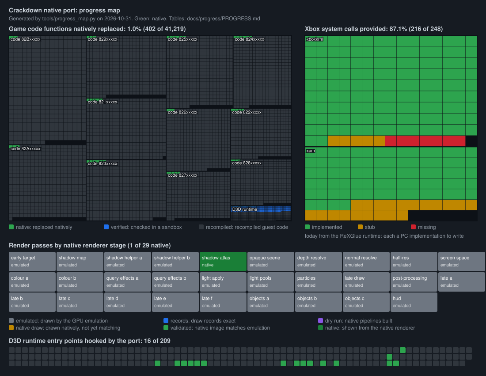

# Native port progress

Generated by `tools/progress_map.py` on 2026-10-30 (run by `tools/progress.py` with every commit). Raw numbers: [progress-map.json](progress-map.json).

## Xbox system calls

Every kernel and XAM function `default.xex` imports. For now the ReXGlue runtime provides them on PC; a full native port replaces each with a PC implementation.

| Library | Implemented | Stub | Missing | Total | % |
|---|---|---|---|---|---|
| xboxkrnl | 137 | 5 | 7 | 149 | 92% |
| xam | 79 | 20 | 0 | 99 | 80% |

Every call

| Library | Function | State |
|---|---|---|
| xboxkrnl | `DbgBreakPoint` | implemented |
| xboxkrnl | `DbgPrint` | missing |
| xboxkrnl | `ExCreateThread` | implemented |
| xboxkrnl | `ExGetXConfigSetting` | implemented |
| xboxkrnl | `ExRegisterTitleTerminateNotification` | implemented |
| xboxkrnl | `ExTerminateThread` | implemented |
| xboxkrnl | `HalReturnToFirmware` | implemented |
| xboxkrnl | `IoDismountVolumeByFileHandle` | implemented |
| xboxkrnl | `KeAcquireSpinLockAtRaisedIrql` | implemented |
| xboxkrnl | `KeBugCheck` | implemented |
| xboxkrnl | `KeBugCheckEx` | implemented |
| xboxkrnl | `KeDelayExecutionThread` | implemented |
| xboxkrnl | `KeEnableFpuExceptions` | implemented |
| xboxkrnl | `KeEnterCriticalRegion` | implemented |
| xboxkrnl | `KeGetCurrentProcessType` | implemented |
| xboxkrnl | `KeInitializeSemaphore` | implemented |
| xboxkrnl | `KeLeaveCriticalRegion` | implemented |
| xboxkrnl | `KeLockL2` | implemented |
| xboxkrnl | `KeQueryPerformanceFrequency` | implemented |
| xboxkrnl | `KeQuerySystemTime` | implemented |
| xboxkrnl | `KeRaiseIrqlToDpcLevel` | implemented |
| xboxkrnl | `KeReleaseSemaphore` | implemented |
| xboxkrnl | `KeReleaseSpinLockFromRaisedIrql` | implemented |
| xboxkrnl | `KeResetEvent` | implemented |
| xboxkrnl | `KeRestoreFloatingPointState` | stub |
| xboxkrnl | `KeResumeThread` | implemented |
| xboxkrnl | `KeSaveFloatingPointState` | stub |
| xboxkrnl | `KeSetAffinityThread` | implemented |
| xboxkrnl | `KeSetBasePriorityThread` | implemented |
| xboxkrnl | `KeSetEvent` | implemented |
| xboxkrnl | `KeTlsAlloc` | implemented |
| xboxkrnl | `KeTlsFree` | implemented |
| xboxkrnl | `KeTlsGetValue` | implemented |
| xboxkrnl | `KeTlsSetValue` | implemented |
| xboxkrnl | `KeUnlockL2` | implemented |
| xboxkrnl | `KeWaitForMultipleObjects` | implemented |
| xboxkrnl | `KeWaitForSingleObject` | implemented |
| xboxkrnl | `KfAcquireSpinLock` | implemented |
| xboxkrnl | `KfLowerIrql` | implemented |
| xboxkrnl | `KfReleaseSpinLock` | implemented |
| xboxkrnl | `KiApcNormalRoutineNop` | implemented |
| xboxkrnl | `MmAllocatePhysicalMemoryEx` | implemented |
| xboxkrnl | `MmFreePhysicalMemory` | implemented |
| xboxkrnl | `MmGetPhysicalAddress` | implemented |
| xboxkrnl | `MmQueryAddressProtect` | implemented |
| xboxkrnl | `MmQueryStatistics` | implemented |
| xboxkrnl | `MmSetAddressProtect` | implemented |
| xboxkrnl | `NtAllocateVirtualMemory` | implemented |
| xboxkrnl | `NtCancelTimer` | implemented |
| xboxkrnl | `NtClearEvent` | implemented |
| xboxkrnl | `NtClose` | implemented |
| xboxkrnl | `NtCreateEvent` | implemented |
| xboxkrnl | `NtCreateFile` | implemented |
| xboxkrnl | `NtCreateMutant` | implemented |
| xboxkrnl | `NtCreateSemaphore` | implemented |
| xboxkrnl | `NtCreateTimer` | implemented |
| xboxkrnl | `NtDeviceIoControlFile` | implemented |
| xboxkrnl | `NtDuplicateObject` | implemented |
| xboxkrnl | `NtFlushBuffersFile` | implemented |
| xboxkrnl | `NtFreeVirtualMemory` | implemented |
| xboxkrnl | `NtOpenFile` | implemented |
| xboxkrnl | `NtQueryDirectoryFile` | implemented |
| xboxkrnl | `NtQueryFullAttributesFile` | implemented |
| xboxkrnl | `NtQueryInformationFile` | implemented |
| xboxkrnl | `NtQueryVirtualMemory` | implemented |
| xboxkrnl | `NtQueryVolumeInformationFile` | implemented |
| xboxkrnl | `NtReadFile` | implemented |
| xboxkrnl | `NtReleaseMutant` | implemented |
| xboxkrnl | `NtReleaseSemaphore` | implemented |
| xboxkrnl | `NtResumeThread` | implemented |
| xboxkrnl | `NtSetEvent` | implemented |
| xboxkrnl | `NtSetInformationFile` | implemented |
| xboxkrnl | `NtSetTimerEx` | implemented |
| xboxkrnl | `NtSuspendThread` | implemented |
| xboxkrnl | `NtWaitForMultipleObjectsEx` | implemented |
| xboxkrnl | `NtWaitForSingleObjectEx` | implemented |
| xboxkrnl | `NtWriteFile` | implemented |
| xboxkrnl | `ObCreateSymbolicLink` | implemented |
| xboxkrnl | `ObDeleteSymbolicLink` | implemented |
| xboxkrnl | `ObDereferenceObject` | implemented |
| xboxkrnl | `ObReferenceObjectByHandle` | implemented |
| xboxkrnl | `RtlCaptureContext` | implemented |
| xboxkrnl | `RtlCompareMemoryUlong` | implemented |
| xboxkrnl | `RtlEnterCriticalSection` | implemented |
| xboxkrnl | `RtlFillMemoryUlong` | implemented |
| xboxkrnl | `RtlFreeAnsiString` | implemented |
| xboxkrnl | `RtlImageXexHeaderField` | implemented |
| xboxkrnl | `RtlInitAnsiString` | implemented |
| xboxkrnl | `RtlInitUnicodeString` | implemented |
| xboxkrnl | `RtlInitializeCriticalSection` | implemented |
| xboxkrnl | `RtlInitializeCriticalSectionAndSpinCount` | implemented |
| xboxkrnl | `RtlLeaveCriticalSection` | implemented |
| xboxkrnl | `RtlMultiByteToUnicodeN` | implemented |
| xboxkrnl | `RtlNtStatusToDosError` | implemented |
| xboxkrnl | `RtlRaiseException` | implemented |
| xboxkrnl | `RtlTimeFieldsToTime` | implemented |
| xboxkrnl | `RtlTimeToTimeFields` | implemented |
| xboxkrnl | `RtlTryEnterCriticalSection` | implemented |
| xboxkrnl | `RtlUnicodeStringToAnsiString` | implemented |
| xboxkrnl | `RtlUnicodeToMultiByteN` | implemented |
| xboxkrnl | `RtlUnwind` | implemented |
| xboxkrnl | `StfsControlDevice` | implemented |
| xboxkrnl | `StfsCreateDevice` | implemented |
| xboxkrnl | `VdCallGraphicsNotificationRoutines` | implemented |
| xboxkrnl | `VdEnableDisableClockGating` | implemented |
| xboxkrnl | `VdEnableRingBufferRPtrWriteBack` | implemented |
| xboxkrnl | `VdGetCurrentDisplayGamma` | implemented |
| xboxkrnl | `VdGetCurrentDisplayInformation` | implemented |
| xboxkrnl | `VdGetSystemCommandBuffer` | implemented |
| xboxkrnl | `VdInitializeEngines` | implemented |
| xboxkrnl | `VdInitializeRingBuffer` | implemented |
| xboxkrnl | `VdInitializeScalerCommandBuffer` | implemented |
| xboxkrnl | `VdIsHSIOTrainingSucceeded` | implemented |
| xboxkrnl | `VdPersistDisplay` | implemented |
| xboxkrnl | `VdQueryVideoFlags` | implemented |
| xboxkrnl | `VdQueryVideoMode` | implemented |
| xboxkrnl | `VdRetrainEDRAM` | implemented |
| xboxkrnl | `VdRetrainEDRAMWorker` | implemented |
| xboxkrnl | `VdSetDisplayMode` | implemented |
| xboxkrnl | `VdSetGraphicsInterruptCallback` | implemented |
| xboxkrnl | `VdSetSystemCommandBufferGpuIdentifierAddress` | implemented |
| xboxkrnl | `VdShutdownEngines` | implemented |
| xboxkrnl | `VdSwap` | implemented |
| xboxkrnl | `XAudioGetVoiceCategoryVolume` | implemented |
| xboxkrnl | `XAudioGetVoiceCategoryVolumeChangeMask` | implemented |
| xboxkrnl | `XAudioRegisterRenderDriverClient` | implemented |
| xboxkrnl | `XAudioSubmitRenderDriverFrame` | implemented |
| xboxkrnl | `XAudioUnregisterRenderDriverClient` | implemented |
| xboxkrnl | `XMACreateContext` | implemented |
| xboxkrnl | `XMAReleaseContext` | implemented |
| xboxkrnl | `XeCryptBnQwBeSigVerify` | stub |
| xboxkrnl | `XeCryptRotSumSha` | stub |
| xboxkrnl | `XeCryptSha` | implemented |
| xboxkrnl | `XeKeysConsolePrivateKeySign` | implemented |
| xboxkrnl | `XeKeysConsoleSignatureVerification` | implemented |
| xboxkrnl | `XeKeysGetKey` | stub |
| xboxkrnl | `XexCheckExecutablePrivilege` | implemented |
| xboxkrnl | `XexGetModuleHandle` | implemented |
| xboxkrnl | `XexGetModuleSection` | implemented |
| xboxkrnl | `XexGetProcedureAddress` | implemented |
| xboxkrnl | `XexLoadImage` | implemented |
| xboxkrnl | `XexUnloadImage` | implemented |
| xboxkrnl | `__C_specific_handler` | implemented |
| xboxkrnl | `_snwprintf` | missing |
| xboxkrnl | `_vscwprintf` | missing |
| xboxkrnl | `_vsnprintf` | missing |
| xboxkrnl | `sprintf` | missing |
| xboxkrnl | `swprintf` | missing |
| xboxkrnl | `vswprintf` | missing |
| xam | `NetDll_WSACloseEvent` | implemented |
| xam | `NetDll_WSACreateEvent` | implemented |
| xam | `NetDll_WSAEventSelect` | stub |
| xam | `NetDll_WSAGetLastError` | implemented |
| xam | `NetDll_WSAStartup` | implemented |
| xam | `NetDll_WSAWaitForMultipleEvents` | implemented |
| xam | `NetDll_XNetConnect` | stub |
| xam | `NetDll_XNetCreateKey` | stub |
| xam | `NetDll_XNetGetConnectStatus` | stub |
| xam | `NetDll_XNetGetTitleXnAddr` | implemented |
| xam | `NetDll_XNetInAddrToString` | implemented |
| xam | `NetDll_XNetInAddrToXnAddr` | implemented |
| xam | `NetDll_XNetQosListen` | implemented |
| xam | `NetDll_XNetQosLookup` | stub |
| xam | `NetDll_XNetQosRelease` | implemented |
| xam | `NetDll_XNetRandom` | implemented |
| xam | `NetDll_XNetRegisterKey` | stub |
| xam | `NetDll_XNetServerToInAddr` | stub |
| xam | `NetDll_XNetStartup` | implemented |
| xam | `NetDll_XNetUnregisterKey` | stub |
| xam | `NetDll_XNetXnAddrToInAddr` | implemented |
| xam | `NetDll___WSAFDIsSet` | implemented |
| xam | `NetDll_accept` | implemented |
| xam | `NetDll_bind` | implemented |
| xam | `NetDll_closesocket` | implemented |
| xam | `NetDll_connect` | implemented |
| xam | `NetDll_getpeername` | stub |
| xam | `NetDll_getsockname` | stub |
| xam | `NetDll_getsockopt` | stub |
| xam | `NetDll_inet_addr` | implemented |
| xam | `NetDll_ioctlsocket` | implemented |
| xam | `NetDll_listen` | implemented |
| xam | `NetDll_recv` | implemented |
| xam | `NetDll_recvfrom` | implemented |
| xam | `NetDll_select` | implemented |
| xam | `NetDll_send` | implemented |
| xam | `NetDll_sendto` | implemented |
| xam | `NetDll_setsockopt` | implemented |
| xam | `NetDll_shutdown` | implemented |
| xam | `NetDll_socket` | implemented |
| xam | `XGetAVPack` | implemented |
| xam | `XGetGameRegion` | implemented |
| xam | `XGetLanguage` | implemented |
| xam | `XGetVideoMode` | implemented |
| xam | `XMsgCancelIORequest` | implemented |
| xam | `XMsgInProcessCall` | implemented |
| xam | `XMsgStartIORequest` | implemented |
| xam | `XMsgStartIORequestEx` | implemented |
| xam | `XNetLogonGetTitleID` | stub |
| xam | `XNotifyGetNext` | implemented |
| xam | `XamAlloc` | implemented |
| xam | `XamContentClose` | implemented |
| xam | `XamContentCreateEnumerator` | implemented |
| xam | `XamContentCreateEx` | implemented |
| xam | `XamContentDelete` | implemented |
| xam | `XamContentGetDeviceState` | implemented |
| xam | `XamContentLaunchImage` | stub |
| xam | `XamCreateEnumeratorHandle` | implemented |
| xam | `XamEnumerate` | implemented |
| xam | `XamFree` | implemented |
| xam | `XamGetExecutionId` | implemented |
| xam | `XamGetPrivateEnumStructureFromHandle` | implemented |
| xam | `XamGetSystemVersion` | implemented |
| xam | `XamInputGetCapabilities` | implemented |
| xam | `XamInputGetKeystrokeEx` | implemented |
| xam | `XamInputGetState` | implemented |
| xam | `XamInputSetState` | implemented |
| xam | `XamLoaderLaunchTitle` | implemented |
| xam | `XamLoaderSetLaunchData` | implemented |
| xam | `XamLoaderTerminateTitle` | implemented |
| xam | `XamNotifyCreateListener` | implemented |
| xam | `XamParseGamerTileKey` | implemented |
| xam | `XamReadTileToTexture` | implemented |
| xam | `XamSessionCreateHandle` | implemented |
| xam | `XamSessionRefObjByHandle` | implemented |
| xam | `XamShowDeviceSelectorUI` | implemented |
| xam | `XamShowFriendsUI` | stub |
| xam | `XamShowGamerCardUIForXUID` | stub |
| xam | `XamShowMarketplaceUI` | stub |
| xam | `XamShowMessageBoxUIEx` | implemented |
| xam | `XamShowSigninUI` | implemented |
| xam | `XamTaskCloseHandle` | implemented |
| xam | `XamTaskSchedule` | implemented |
| xam | `XamTaskShouldExit` | implemented |
| xam | `XamUserAreUsersFriends` | implemented |
| xam | `XamUserCheckPrivilege` | implemented |
| xam | `XamUserCreateAchievementEnumerator` | implemented |
| xam | `XamUserCreateStatsEnumerator` | stub |
| xam | `XamUserGetMembershipTierFromXUID` | stub |
| xam | `XamUserGetName` | implemented |
| xam | `XamUserGetOnlineCountryFromXUID` | stub |
| xam | `XamUserGetSigninState` | implemented |
| xam | `XamUserGetXUID` | implemented |
| xam | `XamUserReadProfileSettings` | implemented |
| xam | `XamUserWriteProfileSettings` | implemented |
| xam | `XamVoiceClose` | implemented |
| xam | `XamVoiceCreate` | implemented |
| xam | `XamVoiceHeadsetPresent` | implemented |
| xam | `XamVoiceSubmitPacket` | stub |

## Game code

The recompiled functions of `default.xex` by address area: natively replaced (hooked to a PC implementation), verified (outputs checked against the recompiled code in the guest sandbox tests), the rest recompiled guest code.

| Area | Native | Verified | Recompiled | Total | % native |
|---|---|---|---|---|---|
| D3D runtime | 24 | 291 | 427 | 742 | 3.2% |
| code 821xxxxx | 0 | 0 | 3871 | 3871 | 0.0% |
| code 822xxxxx | 5 | 0 | 2430 | 2435 | 0.2% |
| code 823xxxxx | 13 | 0 | 3839 | 3852 | 0.3% |
| code 824xxxxx | 13 | 0 | 3340 | 3353 | 0.4% |
| code 825xxxxx | 27 | 0 | 3812 | 3839 | 0.7% |
| code 826xxxxx | 12 | 0 | 3165 | 3177 | 0.4% |
| code 827xxxxx | 2 | 0 | 2501 | 2503 | 0.1% |
| code 828xxxxx | 0 | 0 | 2226 | 2226 | 0.0% |
| code 829xxxxx | 0 | 0 | 3947 | 3947 | 0.0% |
| code 82Axxxxx | 7 | 0 | 4619 | 4626 | 0.2% |
| code 82Bxxxxx | 0 | 0 | 6648 | 6648 | 0.0% |

## Render passes

| Pass | Stage |
|---|---|
| early target | emulated |
| shadow map | emulated |
| shadow helper a | emulated |
| shadow helper b | emulated |
| shadow atlas | validated |
| opaque scene | emulated |
| depth resolve | emulated |
| normal resolve | emulated |
| half-res | emulated |
| screen space | emulated |
| colour a | emulated |
| colour b | emulated |
| query effects a | emulated |
| query effects b | emulated |
| light apply | emulated |
| light pools | emulated |
| particles | emulated |
| late draw | emulated |
| post-processing | emulated |
| late a | emulated |
| late b | emulated |
| late c | emulated |
| late d | emulated |
| late e | emulated |
| late f | emulated |
| objects a | emulated |
| objects b | emulated |
| objects c | emulated |
| hud | emulated |

## D3D runtime entry points

16 of 209 hooked.
